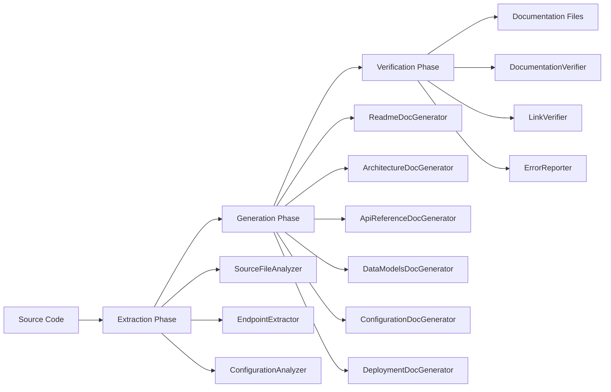

# Design Document: Deutsche Dokumentation & Perfektionierung

## Overview

Dieses Design beschreibt die Verbesserungen am bestehenden Dokumentationsgenerationssystem, um vollständige deutsche Dokumentation ohne Verifikationsfehler zu generieren. Das System besteht aus drei Hauptkomponenten: Extraction (Quellcode-Analyse), Generation (Dokumentationserstellung) und Verification (Qualitätsprüfung).

Die Hauptverbesserungen umfassen:
1. Integration der DocumentationLanguage.cs in alle Generatoren
2. Verbesserung der DTO-Extraktion für vollständige Erfassung
3. Robustere Diagramm-Generierung mit Validierung
4. Konsistente Anchor-Generierung für valide Links
5. Erweiterte Enum-Extraktion und -Dokumentation

## Architecture

Das System folgt einer Pipeline-Architektur mit drei Phasen:



### Bestehende Architektur

Die aktuelle Architektur bleibt erhalten:
- **Extraction Layer**: Analysiert Quellcode und extrahiert Metadaten
- **Generation Layer**: Erstellt Markdown-Dokumentation aus extrahierten Daten
- **Verification Layer**: Prüft generierte Dokumentation auf Vollständigkeit und Korrektheit

### Neue Komponenten

- **DocumentationLanguage**: Zentrale Klasse für alle deutschen Strings (bereits vorhanden)
- **ImprovedDtoExtractor**: Erweiterte DTO-Extraktion mit vollständiger Namespace-Unterstützung
- **MermaidValidator**: Validiert Mermaid-Syntax vor der Generierung
- **AnchorGenerator**: Konsistente Anchor-Generierung für Markdown-Links

## Components and Interfaces

### 1. DocumentationLanguage (bereits vorhanden)

```csharp
public static class DocumentationLanguage
{
    // Überschriften
    public const string Overview = "Übersicht";
    public const string Architecture = "Architektur";
    public const string ApiReference = "API-Referenz";
    public const string DataModels = "Datenmodelle";
    public const string Configuration = "Konfiguration";
    public const string Deployment = "Deployment";
    
    // Beschreibungen
    public const string Endpoints = "Endpunkte";
    public const string RequestBody = "Request-Body";
    public const string ResponseBody = "Response-Body";
    public const string Properties = "Eigenschaften";
    public const string Type = "Typ";
    public const string Description = "Beschreibung";
    public const string Required = "Erforderlich";
    public const string Optional = "Optional";
    
    // ... weitere Strings
}
```

### 2. ImprovedDtoExtractor

```csharp
public class ImprovedDtoExtractor
{
    private readonly SourceFileAnalyzer _sourceAnalyzer;
    
    public List<DtoInfo> ExtractAllDtos(string projectPath)
    {
        // 1. Alle .cs Dateien im Projekt finden
        // 2. Jede Datei mit Roslyn analysieren
        // 3. Klassen mit [Dto] Attribut oder in "Dtos" Namespace finden
        // 4. Alle Properties extrahieren (inkl. geerbte)
        // 5. XML-Dokumentation parsen
        // 6. DtoInfo-Objekte erstellen
    }
    
    private List<PropertyInfo> ExtractProperties(INamedTypeSymbol typeSymbol)
    {
        // Extrahiert Properties inkl. geerbte von Basisklassen
    }
    
    private string ExtractXmlDocumentation(ISymbol symbol)
    {
        // Extrahiert XML-Kommentare für Beschreibungen
    }
}

public class DtoInfo
{
    public string Name { get; set; }
    public string Namespace { get; set; }
    public string Description { get; set; }
    public List<PropertyInfo> Properties { get; set; }
    public bool IsEnum { get; set; }
    public List<EnumValue> EnumValues { get; set; }
}

public class PropertyInfo
{
    public string Name { get; set; }
    public string Type { get; set; }
    public string Description { get; set; }
    public bool IsRequired { get; set; }
    public bool IsInherited { get; set; }
}

public class EnumValue
{
    public string Name { get; set; }
    public int Value { get; set; }
    public string Description { get; set; }
}
```

### 3. Updated Generators mit DocumentationLanguage

```csharp
public class ReadmeDocGenerator
{
    private readonly DocumentationLanguage _lang;
    
    public string Generate(ProjectMetadata metadata)
    {
        var sb = new StringBuilder();
        sb.AppendLine($"# {metadata.ProjectName}");
        sb.AppendLine();
        sb.AppendLine($"## {DocumentationLanguage.Overview}");
        sb.AppendLine(metadata.Description);
        // ... weitere Abschnitte mit deutschen Strings
        return sb.ToString();
    }
}

public class DataModelsDocGenerator
{
    public string Generate(List<DtoInfo> dtos)
    {
        var sb = new StringBuilder();
        sb.AppendLine($"# {DocumentationLanguage.DataModels}");
        sb.AppendLine();
        
        foreach (var dto in dtos.OrderBy(d => d.Name))
        {
            sb.AppendLine($"## {dto.Name}");
            sb.AppendLine();
            sb.AppendLine($"**Namespace:** `{dto.Namespace}`");
            sb.AppendLine();
            sb.AppendLine($"**{DocumentationLanguage.Description}:** {dto.Description}");
            sb.AppendLine();
            
            if (dto.IsEnum)
            {
                GenerateEnumSection(sb, dto);
            }
            else
            {
                GeneratePropertiesSection(sb, dto);
            }
        }
        
        return sb.ToString();
    }
    
    private void GeneratePropertiesSection(StringBuilder sb, DtoInfo dto)
    {
        sb.AppendLine($"### {DocumentationLanguage.Properties}");
        sb.AppendLine();
        sb.AppendLine($"| Name | {DocumentationLanguage.Type} | {DocumentationLanguage.Description} | {DocumentationLanguage.Required} |");
        sb.AppendLine("|------|------|---------------|-----------|");
        
        foreach (var prop in dto.Properties)
        {
            var required = prop.IsRequired ? DocumentationLanguage.Required : DocumentationLanguage.Optional;
            sb.AppendLine($"| {prop.Name} | `{prop.Type}` | {prop.Description} | {required} |");
        }
    }
    
    private void GenerateEnumSection(StringBuilder sb, DtoInfo dto)
    {
        sb.AppendLine($"### Werte");
        sb.AppendLine();
        sb.AppendLine($"| Name | Wert | {DocumentationLanguage.Description} |");
        sb.AppendLine("|------|------|---------------|");
        
        foreach (var enumValue in dto.EnumValues)
        {
            sb.AppendLine($"| {enumValue.Name} | {enumValue.Value} | {enumValue.Description} |");
        }
    }
}

public class ApiReferenceDocGenerator
{
    public string Generate(List<EndpointInfo> endpoints, List<DtoInfo> dtos)
    {
        var sb = new StringBuilder();
        sb.AppendLine($"# {DocumentationLanguage.ApiReference}");
        sb.AppendLine();
        
        foreach (var endpoint in endpoints.OrderBy(e => e.Route))
        {
            sb.AppendLine($"## {endpoint.Method} {endpoint.Route}");
            sb.AppendLine();
            sb.AppendLine($"**{DocumentationLanguage.Description}:** {endpoint.Description}");
            sb.AppendLine();
            
            if (endpoint.RequestDto != null)
            {
                var anchor = AnchorGenerator.Generate(endpoint.RequestDto);
                sb.AppendLine($"**{DocumentationLanguage.RequestBody}:** [{endpoint.RequestDto}](DATA_MODELS.md#{anchor})");
                sb.AppendLine();
            }
            
            if (endpoint.ResponseDto != null)
            {
                var anchor = AnchorGenerator.Generate(endpoint.ResponseDto);
                sb.AppendLine($"**{DocumentationLanguage.ResponseBody}:** [{endpoint.ResponseDto}](DATA_MODELS.md#{anchor})");
                sb.AppendLine();
            }
        }
        
        return sb.ToString();
    }
}
```

### 4. AnchorGenerator

```csharp
public static class AnchorGenerator
{
    public static string Generate(string text)
    {
        // 1. Zu Kleinbuchstaben konvertieren
        // 2. Leerzeichen durch Bindestriche ersetzen
        // 3. Sonderzeichen entfernen (außer Bindestriche)
        // 4. Mehrfache Bindestriche zu einem reduzieren
        
        return text
            .ToLowerInvariant()
            .Replace(" ", "-")
            .Replace("ä", "ae")
            .Replace("ö", "oe")
            .Replace("ü", "ue")
            .Replace("ß", "ss")
            .Regex.Replace(@"[^a-z0-9\-]", "")
            .Regex.Replace(@"-+", "-")
            .Trim('-');
    }
}
```

### 5. MermaidValidator

```csharp
public class MermaidValidator
{
    public ValidationResult Validate(string mermaidCode)
    {
        var errors = new List<string>();
        
        // 1. Prüfe auf ungültige Zeichen in Knotennamen
        // 2. Prüfe auf fehlende Anführungszeichen bei Sonderzeichen
        // 3. Prüfe auf korrekte Syntax (graph, flowchart, etc.)
        // 4. Prüfe auf geschlossene Klammern
        
        return new ValidationResult 
        { 
            IsValid = errors.Count == 0, 
            Errors = errors 
        };
    }
    
    public string SanitizeNodeName(string nodeName)
    {
        // Entfernt oder escaped Sonderzeichen in Knotennamen
        return nodeName
            .Replace("\"", "")
            .Replace("'", "")
            .Replace("[", "")
            .Replace("]", "")
            .Replace("{", "")
            .Replace("}", "")
            .Replace("(", "")
            .Replace(")", "");
    }
}
```

### 6. Enhanced MermaidDiagramGenerator

```csharp
public class MermaidDiagramGenerator
{
    private readonly MermaidValidator _validator;
    
    public string GenerateArchitectureDiagram(ProjectMetadata metadata)
    {
        var sb = new StringBuilder();
        sb.AppendLine("```mermaid");
        sb.AppendLine("graph TB");
        
        foreach (var component in metadata.Components)
        {
            var sanitizedName = _validator.SanitizeNodeName(component.Name);
            sb.AppendLine($"    {sanitizedName}[\"{component.Name}\"]");
        }
        
        foreach (var dependency in metadata.Dependencies)
        {
            var from = _validator.SanitizeNodeName(dependency.From);
            var to = _validator.SanitizeNodeName(dependency.To);
            sb.AppendLine($"    {from} --> {to}");
        }
        
        sb.AppendLine("```");
        
        var diagram = sb.ToString();
        var validation = _validator.Validate(diagram);
        
        if (!validation.IsValid)
        {
            throw new InvalidDiagramException($"Ungültiges Mermaid-Diagramm: {string.Join(", ", validation.Errors)}");
        }
        
        return diagram;
    }
}
```

## Data Models

### DtoInfo
Repräsentiert ein extrahiertes DTO mit allen Metadaten:
- Name: Klassenname
- Namespace: Vollständiger Namespace
- Description: XML-Dokumentation
- Properties: Liste aller Properties (inkl. geerbte)
- IsEnum: Ob es sich um ein Enum handelt
- EnumValues: Liste der Enum-Werte (falls IsEnum = true)

### PropertyInfo
Repräsentiert eine Property eines DTOs:
- Name: Property-Name
- Type: C#-Typ als String
- Description: XML-Dokumentation
- IsRequired: Ob die Property erforderlich ist
- IsInherited: Ob die Property von einer Basisklasse geerbt wurde

### EnumValue
Repräsentiert einen Enum-Wert:
- Name: Enum-Wert-Name
- Value: Numerischer Wert
- Description: XML-Dokumentation

### EndpointInfo
Repräsentiert einen API-Endpoint:
- Method: HTTP-Methode (GET, POST, etc.)
- Route: URL-Route
- Description: Beschreibung des Endpoints
- RequestDto: Name des Request-DTOs (optional)
- ResponseDto: Name des Response-DTOs (optional)
- Parameters: Liste der Route/Query-Parameter

### ValidationResult
Repräsentiert das Ergebnis einer Validierung:
- IsValid: Ob die Validierung erfolgreich war
- Errors: Liste der Fehlermeldungen


## Correctness Properties

*Eine Property ist eine Eigenschaft oder ein Verhalten, das für alle gültigen Ausführungen eines Systems wahr sein sollte - im Wesentlichen eine formale Aussage darüber, was das System tun soll. Properties dienen als Brücke zwischen menschenlesbaren Spezifikationen und maschinell verifizierbaren Korrektheitsgarantien.*

### Property 1: Deutsche Sprachkonsistenz

*Für alle* generierten Dokumentationsdateien sollten alle Überschriften, Beschreibungen und Labels deutsche Strings aus DocumentationLanguage.cs verwenden, und derselbe Begriff sollte immer mit demselben deutschen String übersetzt werden.

**Validates: Requirements 1.1, 1.4**

### Property 2: Vollständige DTO-Extraktion mit Metadaten

*Für alle* DTOs im Quellcode sollte der Extractor jedes DTO mit vollständigem Namen, Namespace, Beschreibung, allen Properties (inklusive geerbte) und deren Typen extrahieren.

**Validates: Requirements 2.1, 2.2, 2.3, 2.4, 2.5**

### Property 3: Eindeutige und vollständige DTO-Dokumentation

*Für jedes* extrahierte DTO sollte in DATA_MODELS.md genau ein Dokumentationsabschnitt existieren, der Name, Namespace, Beschreibung und alle Properties in einer Tabelle enthält.

**Validates: Requirements 3.1, 3.5**

### Property 4: Valide DTO-Referenzen in API-Dokumentation

*Für alle* DTO-Referenzen in API_REFERENCE.md sollte der generierte Link das Format `[DtoName](DATA_MODELS.md#anchor)` haben, wobei der Anchor existiert und korrekt auf den DTO-Abschnitt in DATA_MODELS.md zeigt.

**Validates: Requirements 3.2**

### Property 5: Vollständige Endpoint-Extraktion und -Dokumentation

*Für alle* API-Endpoints im Quellcode sollte der Extractor jeden Endpoint mit HTTP-Methode, vollständiger Route, Beschreibung, Request-DTO und Response-DTO extrahieren und dokumentieren.

**Validates: Requirements 4.1, 4.2, 4.4**

### Property 6: Vollständige Konfigurationsdokumentation

*Für alle* Konfigurationseinträge (Umgebungsvariablen und appsettings.json) sollte der Extractor jeden Eintrag mit Name, Typ, Standardwert und Beschreibung extrahieren und in CONFIGURATION.md dokumentieren.

**Validates: Requirements 5.1, 5.2**

### Property 7: Valide Mermaid-Diagramme mit deutschen Beschriftungen

*Für alle* generierten Mermaid-Diagramme sollte die Syntax valide sein (keine Parsing-Fehler), Knotennamen sollten keine unescapten Sonderzeichen enthalten, und alle Beschriftungen sollten deutsche Strings verwenden.

**Validates: Requirements 6.1, 6.2, 6.4**

### Property 8: Vollständige Enum-Extraktion und -Dokumentation

*Für alle* Enum-Typen im Quellcode sollte der Extractor jeden Enum mit allen Werten (Name und numerischer Wert) extrahieren und in DATA_MODELS.md dokumentieren.

**Validates: Requirements 7.1, 7.2**

### Property 9: Konsistente Anchor-Generierung (Round-Trip)

*Für jeden* Text sollte die Anchor-Generierung idempotent sein: `AnchorGenerator.Generate(text)` sollte immer denselben Anchor zurückgeben, und Leerzeichen sollten durch Bindestriche ersetzt werden, Sonderzeichen sollten entfernt werden.

**Validates: Requirements 8.4**

### Property 10: Valide Markdown-Links

*Für alle* Markdown-Links in generierten Dokumenten sollten alle Anchor-Links auf existierende Anchors zeigen und alle Datei-Links auf existierende Dateien zeigen.

**Validates: Requirements 8.1, 8.2, 8.3**

### Property 11: Null-Fehler-Verifikation

*Nach* vollständiger Dokumentationsgenerierung sollte die Verification Engine 0 Fehler melden (0 Completeness-Fehler, 0 DTO-Verification-Fehler, 0 Endpoint-Fehler, 0 Konfigurationsfehler, 0 Diagramm-Parsing-Fehler, 0 Enum-Fehler, 0 Broken-Anchor-Fehler).

**Validates: Requirements 3.3, 3.4, 4.3, 5.3, 6.3, 7.3, 8.3, 9.1, 9.2, 9.3, 9.4, 9.5, 9.6, 9.7**

## Error Handling

### DTO-Extraktion Fehler

**Fehlende XML-Dokumentation:**
- Wenn ein DTO keine XML-Dokumentation hat, sollte eine Warnung geloggt werden
- Die Beschreibung sollte auf einen Standardwert gesetzt werden (z.B. "Keine Beschreibung verfügbar")
- Die Extraktion sollte fortgesetzt werden

**Ungültige Property-Typen:**
- Wenn ein Property-Typ nicht aufgelöst werden kann, sollte der Typ als "unknown" markiert werden
- Eine Warnung sollte geloggt werden mit Dateiname und Zeilennummer
- Die Extraktion sollte fortgesetzt werden

**Vererbungsfehler:**
- Wenn eine Basisklasse nicht gefunden werden kann, sollte eine Warnung geloggt werden
- Nur die direkt deklarierten Properties sollten extrahiert werden
- Die Extraktion sollte fortgesetzt werden

### Mermaid-Diagramm Fehler

**Ungültige Syntax:**
- Wenn ein generiertes Diagramm ungültige Syntax hat, sollte eine InvalidDiagramException geworfen werden
- Die Exception sollte die spezifischen Validierungsfehler enthalten
- Die Dokumentationsgenerierung sollte abgebrochen werden (Fail-Fast)

**Sonderzeichen in Knotennamen:**
- Sonderzeichen sollten automatisch entfernt oder escaped werden
- Keine Exception sollte geworfen werden
- Eine Debug-Meldung sollte geloggt werden

### Link-Validierung Fehler

**Broken Anchors:**
- Wenn ein Link auf einen nicht-existierenden Anchor zeigt, sollte ein Verifikationsfehler gemeldet werden
- Der Fehler sollte Quelldatei, Zeilennummer und Ziel-Anchor enthalten
- Die Verifikation sollte fortgesetzt werden, um alle Fehler zu sammeln

**Fehlende Dateien:**
- Wenn ein Link auf eine nicht-existierende Datei zeigt, sollte ein Verifikationsfehler gemeldet werden
- Der Fehler sollte Quelldatei und Zieldatei enthalten
- Die Verifikation sollte fortgesetzt werden

### Konfigurationsanalyse Fehler

**Fehlende appsettings.json:**
- Wenn appsettings.json nicht existiert, sollte eine Warnung geloggt werden
- Die Konfigurationsdokumentation sollte nur Umgebungsvariablen enthalten
- Die Generierung sollte fortgesetzt werden

**Ungültiges JSON:**
- Wenn appsettings.json ungültiges JSON enthält, sollte eine Exception geworfen werden
- Die Exception sollte die JSON-Parsing-Fehler enthalten
- Die Dokumentationsgenerierung sollte abgebrochen werden

## Testing Strategy

### Dual Testing Approach

Das System verwendet sowohl Unit-Tests als auch Property-Based Tests für umfassende Abdeckung:

**Unit Tests:**
- Testen spezifische Beispiele und Edge Cases
- Testen Fehlerbehandlung und Ausnahmefälle
- Testen Integration zwischen Komponenten
- Fokus auf konkrete Szenarien

**Property-Based Tests:**
- Testen universelle Eigenschaften über viele generierte Inputs
- Verwenden NUnit mit FsCheck für C#
- Minimum 100 Iterationen pro Property-Test
- Fokus auf allgemeine Korrektheit

### Property-Based Testing Configuration

**Framework:** FsCheck mit NUnit für C#

**Konfiguration:**
```csharp
[Property(MaxTest = 100)]
public Property PropertyName()
{
    // Feature: deutsche-dokumentation-perfektionierung, Property 1: Deutsche Sprachkonsistenz
    return Prop.ForAll(/* generators */, (inputs) => 
    {
        // Test implementation
    });
}
```

**Test-Tagging:**
Jeder Property-Test muss mit einem Kommentar versehen werden:
```csharp
// Feature: deutsche-dokumentation-perfektionierung, Property {number}: {property_text}
```

### Test Coverage

**DTO-Extraktion (Property 2):**
- Unit Tests: Spezifische DTOs mit bekannten Properties
- Property Tests: Zufällig generierte DTOs mit verschiedenen Property-Typen und Vererbungshierarchien

**DTO-Dokumentation (Property 3, 4):**
- Unit Tests: Spezifische DTOs und deren erwartete Markdown-Ausgabe
- Property Tests: Zufällige DTOs, Prüfung auf Vollständigkeit und Eindeutigkeit

**Endpoint-Dokumentation (Property 5):**
- Unit Tests: Spezifische Controller mit bekannten Endpoints
- Property Tests: Zufällig generierte Endpoints mit verschiedenen HTTP-Methoden und DTOs

**Mermaid-Diagramme (Property 7):**
- Unit Tests: Spezifische Diagramme mit bekannten Sonderzeichen
- Property Tests: Zufällig generierte Knotennamen mit verschiedenen Sonderzeichen

**Anchor-Generierung (Property 9):**
- Unit Tests: Spezifische Texte mit bekannten Sonderzeichen
- Property Tests: Zufällige Texte, Prüfung auf Idempotenz und Konsistenz

**Link-Validierung (Property 10):**
- Unit Tests: Spezifische Links mit bekannten Zielen
- Property Tests: Zufällig generierte Links, Prüfung auf Existenz der Ziele

**Null-Fehler-Verifikation (Property 11):**
- Integration Tests: Vollständige Dokumentationsgenerierung mit realem Projekt
- Prüfung, dass Verification Engine 0 Fehler meldet

### Test Organization

```
PocketLawyer.Tests/
├── Documentation/
│   ├── Extraction/
│   │   ├── DtoExtractionTests.cs (Unit)
│   │   ├── DtoExtractionProperties.cs (Property)
│   │   ├── EndpointExtractionTests.cs (Unit)
│   │   ├── EndpointExtractionProperties.cs (Property)
│   │   └── ConfigurationAnalyzerTests.cs (Unit)
│   ├── Generation/
│   │   ├── DataModelsDocGeneratorTests.cs (Unit)
│   │   ├── DataModelsDocGeneratorProperties.cs (Property)
│   │   ├── ApiReferenceDocGeneratorTests.cs (Unit)
│   │   ├── MermaidDiagramGeneratorTests.cs (Unit)
│   │   ├── MermaidDiagramGeneratorProperties.cs (Property)
│   │   ├── AnchorGeneratorTests.cs (Unit)
│   │   └── AnchorGeneratorProperties.cs (Property)
│   └── Verification/
│       ├── DocumentationVerifierIntegrationTests.cs (Integration)
│       ├── LinkVerifierTests.cs (Unit)
│       └── LinkVerifierProperties.cs (Property)
```

### Example Property Test

```csharp
[TestFixture]
public class AnchorGeneratorProperties
{
    [Property(MaxTest = 100)]
    public Property AnchorGenerationIsIdempotent()
    {
        // Feature: deutsche-dokumentation-perfektionierung, Property 9: Konsistente Anchor-Generierung
        return Prop.ForAll<string>(text =>
        {
            var anchor1 = AnchorGenerator.Generate(text);
            var anchor2 = AnchorGenerator.Generate(text);
            
            return anchor1 == anchor2;
        });
    }
    
    [Property(MaxTest = 100)]
    public Property AnchorGenerationReplacesSpacesWithDashes()
    {
        // Feature: deutsche-dokumentation-perfektionierung, Property 9: Konsistente Anchor-Generierung
        return Prop.ForAll<NonEmptyString>(text =>
        {
            var anchor = AnchorGenerator.Generate(text.Get);
            
            return !anchor.Contains(" ");
        });
    }
}
```

### Example Unit Test

```csharp
[TestFixture]
public class DataModelsDocGeneratorTests
{
    [Test]
    public void Generate_WithSingleDto_CreatesCorrectMarkdown()
    {
        // Arrange
        var dto = new DtoInfo
        {
            Name = "UserDto",
            Namespace = "PocketLawyer.Dtos",
            Description = "Repräsentiert einen Benutzer",
            Properties = new List<PropertyInfo>
            {
                new PropertyInfo { Name = "Id", Type = "int", Description = "Benutzer-ID", IsRequired = true },
                new PropertyInfo { Name = "Name", Type = "string", Description = "Benutzername", IsRequired = true }
            }
        };
        
        var generator = new DataModelsDocGenerator();
        
        // Act
        var markdown = generator.Generate(new List<DtoInfo> { dto });
        
        // Assert
        Assert.That(markdown, Does.Contain("## UserDto"));
        Assert.That(markdown, Does.Contain("**Namespace:** `PocketLawyer.Dtos`"));
        Assert.That(markdown, Does.Contain("**Beschreibung:** Repräsentiert einen Benutzer"));
        Assert.That(markdown, Does.Contain("| Id | `int` | Benutzer-ID | Erforderlich |"));
        Assert.That(markdown, Does.Contain("| Name | `string` | Benutzername | Erforderlich |"));
    }
}
```
