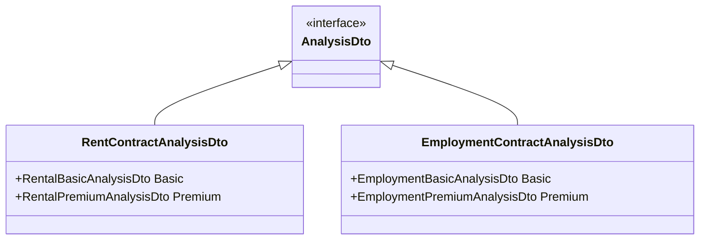
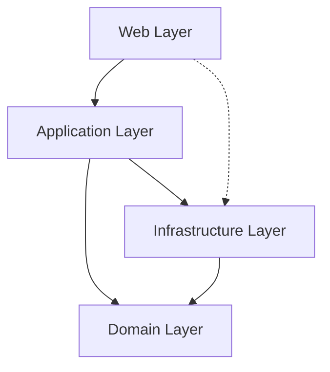

# Design Document: Documentation Phase 1

## Overview

This design describes the implementation approach for creating Phase 1 documentation for the PocketLawyer project. The core principle is **truth verification** - every technical claim must be extracted from and verified against actual source code to prevent hallucinations.

The documentation generation process follows a three-step pattern for each document:
1. **Extract** - Read source files and gather facts
2. **Document** - Write markdown based on extracted facts
3. **Verify** - Cross-reference every claim against source code

### Documentation Scope

Phase 1 creates six core documents:
- **README.md** - Project overview and quick start guide
- **docs/ARCHITECTURE.md** - System architecture and design principles
- **docs/API_REFERENCE.md** - Complete API documentation
- **docs/DATA_MODELS.md** - DTO structures and relationships
- **docs/CONFIGURATION.md** - Configuration reference
- **docs/DEPLOYMENT.md** - Deployment and setup guide

### Key Design Principles

1. **Code as Source of Truth** - All technical information extracted from actual source files
2. **Traceability** - Every claim references specific file locations
3. **Verification First** - Automated checks prevent inaccuracies
4. **Mermaid Diagrams** - Visual representations based on actual code structure
5. **Cross-Referencing** - Documents link to each other for navigation

## Architecture

### Documentation Generation Pipeline

The documentation generation follows this pipeline:

```
Source Code → Extraction → Documentation → Verification → Output
     ↓            ↓              ↓              ↓            ↓
  .cs files   Read files    Write .md     Check claims   docs/
  .json       Parse AST     Format text   Validate refs  README.md
  .csproj     Extract info  Add diagrams  Link check
```

### Component Responsibilities

**Source Code Analyzer**
- Reads C# source files
- Extracts class names, methods, properties
- Analyzes using statements for dependencies
- Parses attributes and decorators
- Identifies namespace structure

**Configuration Analyzer**
- Reads JSON configuration files
- Parses .csproj for dependencies and .NET version
- Extracts option class definitions
- Maps configuration keys to option properties

**Documentation Generator**
- Creates markdown files with extracted information
- Generates Mermaid diagrams from code structure
- Formats code references consistently
- Creates cross-reference links between documents

**Verification Engine**
- Validates that documented endpoints exist in controllers
- Checks that documented DTOs match actual classes
- Verifies configuration keys exist in files
- Validates internal markdown links
- Reports discrepancies with specific file locations

## Components and Interfaces

### Source File Locations

The implementation will read from these key locations:

**Architecture Sources:**
- `Web/Program.cs` - Application startup and DI configuration
- `Web/PocketController.cs` - HTTP and WebSocket endpoints
- `Application/Agents/` - Contract analysis agents
- `Domain/`, `Application/`, `Infrastructure/`, `Web/` - Layer structure

**API Sources:**
- `Web/PocketController.cs` - Controller with route attributes
- `Infrastructure/WebSocketAnalysisHandler.cs` - WebSocket handling
- `Domain/Dtos/` - All DTO definitions
- `Application/Exceptions/` - Exception types

**Data Model Sources:**
- `Domain/Dtos/Employment/` - Employment contract DTOs
- `Domain/Dtos/Rental/` - Rental contract DTOs
- `Domain/Dtos/Shared/` - Shared DTOs and interfaces

**Configuration Sources:**
- `appsettings.json` - Main configuration
- `appsettings.Development.json` - Development overrides
- `Options/*.cs` - All option classes (NebiusOptions, PathOptions, UploadOptions, etc.)

**Deployment Sources:**
- `PocketLawyer.csproj` - .NET version and NuGet packages
- `data/Context/` - Context file structure
- `Properties/launchSettings.json` - Launch configuration

### Document Structure Templates

Each document follows a consistent structure:

**README.md:**
```markdown
# Project Title
Brief description

## Features
- Feature list

## Prerequisites
- .NET version (from .csproj)
- Dependencies

## Quick Start
1. Clone repository
2. Restore dependencies
3. Configure API keys
4. Run application

## Documentation
Links to docs/

## License
```

**ARCHITECTURE.md:**
```markdown
# Architecture

## Overview
Onion Architecture description

## Layers
### Web Layer
- Controllers (from Web/)
- WebSocket handlers

### Application Layer
- Agents (from Application/Agents/)
- Use cases

### Domain Layer
- DTOs (from Domain/Dtos/)
- Core logic

### Infrastructure Layer
- AI services
- File processing
- Schema providers

## Dependencies
Dependency flow diagram

## Design Principles
SOLID, DRY, YAGNI with code examples

## Diagrams
- Layered Component Diagram
- Dependency Graph
- Package Structure
```

**API_REFERENCE.md:**
```markdown
# API Reference

## WebSocket Endpoints

### /employment-analysis
- Handler: EmploymentContractAgent
- Message format: WebSocketFileDto
- Response: EmploymentContractAnalysisDto

### /rental-analysis
- Handler: RentalContractAgent
- Message format: WebSocketFileDto
- Response: RentContractAnalysisDto

## HTTP Endpoints

### GET /api/schemas/{contractType}/{tier}/{step}
- Controller: PocketController
- Parameters: contractType, tier, step
- Response: JSON schema

## Message Formats
DTO structures with properties

## Error Handling
Exception types and responses

## Diagrams
- API Endpoint Overview
- Message Sequence Diagrams
```

**DATA_MODELS.md:**
```markdown
# Data Models

## DTO Hierarchy
Class diagram showing inheritance

## Employment Contract DTOs
- EmploymentContractAnalysisDto
- EmploymentBasicAnalysisDto
- EmploymentPremiumAnalysisDto

## Rental Contract DTOs
- RentContractAnalysisDto
- RentalBasicAnalysisDto
- RentalPremiumAnalysisDto

## Shared DTOs
- AnalysisDto
- ContractValidationDto
- FileContentDto
- WebSocketFileDto

## Enumerations
Enum types with values

## Diagrams
- DTO Class Diagram
- Inheritance Hierarchy
- Namespace Structure
```

**CONFIGURATION.md:**
```markdown
# Configuration

## appsettings.json Structure
Complete structure with descriptions

## Logging Configuration
File logging options

## AI Service Configuration
- Nebius (NebiusOptions)
- Gemini (GeminiOptions)
- Claude (ClaudeOptions)

## Path Configuration
PathOptions class

## Upload Configuration
UploadOptions class

## Context Configuration
ContextOptions class

## User Secrets
How to configure secrets

## Environment Variables
Supported variables

## Diagrams
- Configuration Hierarchy
- Logging Architecture
```

**DEPLOYMENT.md:**
```markdown
# Deployment

## System Requirements
- .NET 8 SDK (from .csproj)
- Dependencies (from .csproj)

## Installation
Step-by-step instructions

## Configuration
Environment setup

## Context Files
data/Context/ structure

## Running the Application
dotnet run commands

## Health Checks
Verification steps

## Diagrams
- Deployment Architecture
- Directory Structure
```

## Data Models

### Extraction Data Structures

**SourceFileInfo:**
```
{
  path: string
  namespace: string
  classes: ClassInfo[]
  usings: string[]
}
```

**ClassInfo:**
```
{
  name: string
  namespace: string
  properties: PropertyInfo[]
  methods: MethodInfo[]
  baseClass: string?
  interfaces: string[]
  attributes: AttributeInfo[]
}
```

**PropertyInfo:**
```
{
  name: string
  type: string
  attributes: AttributeInfo[]
}
```

**EndpointInfo:**
```
{
  path: string
  method: string (GET, POST, WebSocket)
  controller: string
  action: string
  parameters: ParameterInfo[]
}
```

**ConfigurationInfo:**
```
{
  key: string
  value: any
  optionClass: string?
  propertyName: string?
}
```

### Verification Data Structures

**VerificationResult:**
```
{
  documentPath: string
  checks: Check[]
  passed: boolean
  errors: VerificationError[]
}
```

**Check:**
```
{
  type: string (endpoint, dto, config, link)
  claim: string
  sourceReference: string
  passed: boolean
}
```

**VerificationError:**
```
{
  type: string
  claim: string
  expectedSource: string
  message: string
}
```


## Correctness Properties

*A property is a characteristic or behavior that should hold true across all valid executions of a system—essentially, a formal statement about what the system should do. Properties serve as the bridge between human-readable specifications and machine-verifiable correctness guarantees.*

### Core Verification Properties

These properties ensure that documentation accurately reflects the actual codebase:

**Property 1: Documented endpoints exist in source code**
*For any* documented API endpoint (WebSocket or HTTP), that endpoint must exist in the actual controller source code with matching path, method, and handler.
**Validates: Requirements 2.1, 2.2, 2.5, 9.3**

**Property 2: Documented DTO properties match actual classes**
*For any* documented DTO property (name, type, attributes), that property must exist in the actual DTO class definition with matching characteristics.
**Validates: Requirements 2.3, 2.6, 3.2, 3.6, 6.2, 9.1**

**Property 3: Documented configuration matches actual files**
*For any* documented configuration key or option property, that configuration must exist in either appsettings.json files or the corresponding option class with matching type and structure.
**Validates: Requirements 4.1, 4.2, 4.5, 4.6, 6.3, 9.2**

**Property 4: File references point to existing files**
*For any* file path referenced in documentation (code files, configuration files, directories), that file or directory must exist in the actual repository.
**Validates: Requirements 1.5, 5.5, 6.4, 8.1, 8.2, 8.3, 8.4, 10.7**

**Property 5: Diagram classes exist in codebase**
*For any* class name appearing in a Mermaid diagram (class diagrams, component diagrams, architecture diagrams), that class must exist in the actual codebase with matching namespace.
**Validates: Requirements 1.3, 3.4, 7.1, 7.5**

**Property 6: Documented dependencies match using statements**
*For any* documented dependency relationship between components, that dependency must be reflected in actual using statements or references in the source code.
**Validates: Requirements 1.2, 7.2**

**Property 7: Markdown links resolve correctly**
*For any* internal markdown link in documentation (relative links, anchor links), that link must resolve to an existing file or valid anchor within the documentation.
**Validates: Requirements 6.5**

**Property 8: Documented inheritance matches class declarations**
*For any* documented inheritance relationship between DTOs, that inheritance must match the actual base class declaration in the source code.
**Validates: Requirements 3.3**

**Property 9: Documented .NET version matches project file**
*For any* documented .NET version or framework requirement, that version must match the TargetFramework specified in PocketLawyer.csproj.
**Validates: Requirements 5.1, 10.4**

**Property 10: Documented NuGet packages exist in project file**
*For any* documented NuGet package dependency, that package must exist in the PackageReference elements of PocketLawyer.csproj.
**Validates: Requirements 5.2**

**Property 11: Documented folder structure matches actual directories**
*For any* documented folder or directory structure (architecture layers, context directories), those directories must exist in the actual repository.
**Validates: Requirements 1.1, 5.3, 7.4**

**Property 12: Documented enums match actual definitions**
*For any* documented enumeration value, that value must exist in the actual enum definition in the source code.
**Validates: Requirements 3.5**

**Property 13: Documented exceptions exist in codebase**
*For any* documented exception type or error response, that exception class must exist in the Application/Exceptions/ directory or standard .NET exceptions.
**Validates: Requirements 2.4**

**Property 14: Cross-references between documents are valid**
*For any* cross-reference link from one documentation file to another, the target document must exist and the link must be correctly formatted.
**Validates: Requirements 11.7**

### Extraction Properties

These properties ensure complete information extraction:

**Property 15: All DTOs in directory are documented**
*For any* .cs file in the Domain/Dtos/ directory, that DTO class must appear in the DATA_MODELS.md documentation.
**Validates: Requirements 3.1**

**Property 16: All option classes are documented**
*For any* .cs file in the Options/ directory, that option class must appear in the CONFIGURATION.md documentation.
**Validates: Requirements 4.2**

**Property 17: All controller endpoints are documented**
*For any* HTTP or WebSocket endpoint defined in PocketController.cs, that endpoint must appear in the API_REFERENCE.md documentation.
**Validates: Requirements 2.1, 2.2**

## Error Handling

### Verification Errors

When verification fails, the system reports structured errors:

**Missing Source Reference Error:**
```
Error: Documented item not found in source code
  Document: docs/API_REFERENCE.md
  Claim: "GET /api/users endpoint"
  Expected Source: Web/PocketController.cs
  Issue: No matching route attribute found
```

**Invalid File Reference Error:**
```
Error: Referenced file does not exist
  Document: docs/DEPLOYMENT.md
  Claim: "Copy files from data/Config/"
  Expected Path: data/Config/
  Issue: Directory not found in repository
```

**Broken Link Error:**
```
Error: Internal link does not resolve
  Document: README.md
  Link: [Architecture](docs/ARCH.md)
  Issue: Target file docs/ARCH.md does not exist
```

**Property Mismatch Error:**
```
Error: Documented property does not match source
  Document: docs/DATA_MODELS.md
  Claim: "Property 'UserId' of type 'int'"
  Source: Domain/Dtos/Shared/AnalysisDto.cs
  Actual: Property 'UserId' of type 'string'
```

### Error Recovery

When verification errors occur:
1. **Report all errors** - Don't stop at first error, collect all issues
2. **Provide context** - Show document location, claim, and expected source
3. **Suggest fixes** - Indicate what needs to be corrected
4. **Block completion** - Don't mark documentation as complete until all errors resolved

### Handling Unverifiable Information

Some information cannot be automatically verified:
- **Design rationale** - Why certain decisions were made
- **Usage examples** - How to use the API (unless extracted from tests)
- **Best practices** - Recommendations not encoded in code

For unverifiable information:
- **Mark as "TODO: Verify"** if uncertain
- **Omit entirely** if cannot be verified
- **Extract from comments** if available in code comments
- **Reference tests** if examples exist in test files

## Testing Strategy

### Dual Testing Approach

The documentation system requires both unit tests and property-based tests:

**Unit Tests** focus on:
- Specific file parsing (e.g., parsing a known .csproj file)
- Markdown generation for known inputs
- Error message formatting
- Link resolution for specific cases
- Moving README to legacy directory (Requirement 10.1)
- Creating specific documents (Requirements 11.1-11.6)
- Verification error reporting (Requirement 6.6)

**Property-Based Tests** focus on:
- Universal verification properties (Properties 1-17)
- Testing across many different source files
- Randomized DTO structures
- Various configuration combinations
- Different endpoint patterns

### Property Test Configuration

Each property test must:
- Run minimum **100 iterations** (due to randomization)
- Reference its design document property
- Use tag format: **Feature: documentation-phase-1, Property {number}: {property_text}**

### Test Organization

```
PocketLawyer.Tests/
  Documentation/
    Extraction/
      SourceFileAnalyzerTests.cs      # Unit tests
      ConfigurationAnalyzerTests.cs   # Unit tests
      DtoExtractorTests.cs            # Unit tests
    
    Generation/
      MarkdownGeneratorTests.cs       # Unit tests
      MermaidDiagramTests.cs          # Unit tests
    
    Verification/
      EndpointVerificationTests.cs    # Property tests (Property 1)
      DtoVerificationTests.cs         # Property tests (Property 2)
      ConfigVerificationTests.cs      # Property tests (Property 3)
      FileReferenceTests.cs           # Property tests (Property 4)
      DiagramVerificationTests.cs     # Property tests (Property 5)
      DependencyVerificationTests.cs  # Property tests (Property 6)
      LinkVerificationTests.cs        # Property tests (Property 7)
      InheritanceTests.cs             # Property tests (Property 8)
      VersionVerificationTests.cs     # Property tests (Property 9, 10)
      StructureVerificationTests.cs   # Property tests (Property 11)
      EnumVerificationTests.cs        # Property tests (Property 12)
      ExceptionVerificationTests.cs   # Property tests (Property 13)
      CrossReferenceTests.cs          # Property tests (Property 14)
      CompletenessTests.cs            # Property tests (Property 15-17)
```

### Example Property Test

```csharp
[Property(DisplayName = "Feature: documentation-phase-1, Property 1: Documented endpoints exist in source code")]
public Property DocumentedEndpointsExistInSource()
{
    return Prop.ForAll(
        Arb.Generate<DocumentedEndpoint>(),
        Arb.Generate<ControllerSourceCode>(),
        (endpoint, source) =>
        {
            // Given: A documented endpoint
            var documentation = GenerateApiDocumentation(endpoint);
            
            // When: Verification runs
            var result = VerifyEndpointExists(endpoint, source);
            
            // Then: Endpoint must exist in source if documented
            return result.Exists == documentation.Contains(endpoint.Path);
        }
    ).QuickCheckThrowOnFailure();
}
```

### Testing Tools

- **xUnit** - Test framework
- **FsCheck** - Property-based testing library
- **FluentAssertions** - Assertion library
- **Roslyn** - C# code analysis for parsing source files
- **System.Text.Json** - JSON parsing for configuration files
- **System.Xml.Linq** - XML parsing for .csproj files

## Implementation Notes

### Parsing Strategies

**C# Source Files:**
- Use Roslyn for accurate parsing
- Extract class names, properties, methods, attributes
- Analyze using statements for dependencies
- Handle partial classes correctly

**Configuration Files:**
- Use System.Text.Json for appsettings.json
- Parse option classes using Roslyn
- Map JSON keys to option properties

**Project Files:**
- Use System.Xml.Linq for .csproj parsing
- Extract TargetFramework
- Extract PackageReference elements

**Markdown Files:**
- Use regex for link extraction
- Validate relative paths
- Check anchor existence

### Mermaid Diagram Generation

Generate diagrams programmatically from extracted data:

**Class Diagram Example:**


**Dependency Graph Example:**


### Code Reference Format

Consistently format code references:
- Classes: `ClassName` in `Path/To/File.cs`
- Methods: `MethodName()` in `ClassName` (`Path/To/File.cs`)
- Properties: `PropertyName` property of `ClassName` (`Path/To/File.cs`)
- Configuration: `Section:Key` in `appsettings.json`
- Options: `PropertyName` in `OptionsClassName` (`Options/File.cs`)

### Document Generation Order

Generate documents in this order to handle dependencies:
1. **DATA_MODELS.md** - Foundation for other docs
2. **CONFIGURATION.md** - Needed for deployment
3. **API_REFERENCE.md** - References data models
4. **ARCHITECTURE.md** - References all components
5. **DEPLOYMENT.md** - References configuration and architecture
6. **README.md** - Links to all other docs

### Verification Execution

Run verification after each document is generated:
1. Generate document
2. Run verification properties
3. Report errors
4. Fix errors
5. Re-verify
6. Proceed to next document

This ensures errors are caught early and don't propagate to dependent documents.
