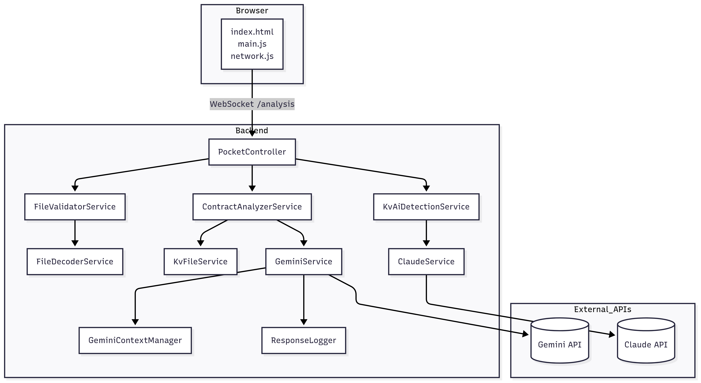
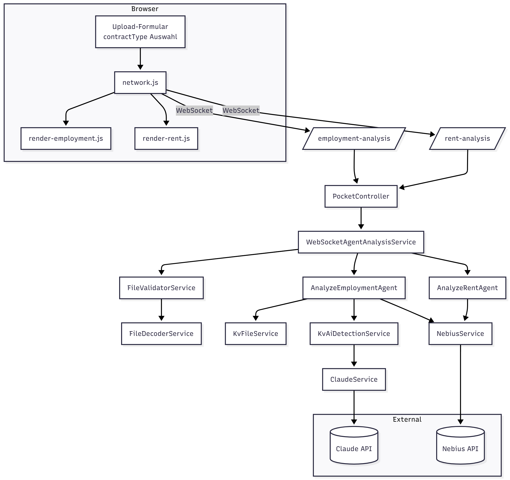
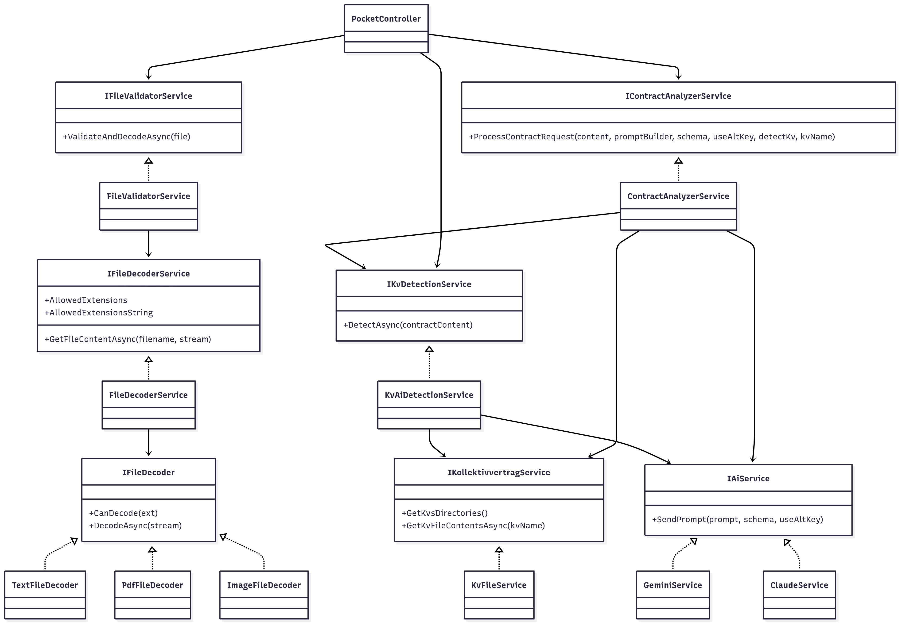

# PocketLawyer

PocketLawyer ist eine Webanwendung auf Basis von **ASP.NET 8**, welche Arbeitsverträge analysiert. PDF-Dateien werden dabei mit **UglyToad.PdfPig** ausgelesen, während Bilddateien per **Tesseract OCR** verarbeitet werden. Die extrahierten Texte werden an verschiedene KI‑Dienste gesendet und die Ergebnisse übersichtlich dargestellt.

Im Ordner `docs/Diagrams` liegen mehrere Ablauf‑ und Architekturdiagramme. Eine Übersicht der im Projekt verwendeten Entwurfsmuster findet sich in [DesignPatterns_de.md](docs/DesignPatterns_de.md).

## Funktionsweise
* **Gemini API**: Hauptdienst für die Analyse von Verträgen.
* **Claude API**: Optionaler Dienst, der aktuell für die Erkennung des passenden Kollektivvertrags genutzt wird.
* **UglyToad.PdfPig**: Liest Text direkt aus PDF-Dokumenten.
* **Tesseract OCR**: Liest Bilddateien (JPG, PNG) per OCR aus und wandelt sie in Text um.

Eine Datei wird zunächst vorvalidiert. Ist sie lesbar und als Arbeitsvertrag erkennbar, wird eine tiefere Analyse durchgeführt. Die Analyse bewertet Klauseln, gibt Zusammenfassungen und stellt Verstöße gegen Gesetz und Kollektivvertrag heraus.

## Ordnerstruktur

```
Dtos/            Enthält die Datenobjekte (DTOs) für Requests und Responses.
Infrastructure/  Implementierung der Dienste (Gemini, Claude, Dateidecoder, KV-Erkennung etc.).
Service/         Schnittstellen und gemeinsame Service-Definitionen.
wwwroot/         Statische Dateien der Weboberfläche (HTML, JS, CSS, Medien).
data/Responses/  Ablage für gesicherte Antworten der KI.
data/Samples/    Beispielverträge für Tests.
docs/Diagrams/   Architektur- und Ablaufdiagramme.
data/tessdata/   Sprachdaten für Tesseract OCR.
data/KVS/        Kollektivverträge für die Analyse.
data/Context/    Vorverarbeitete Kontextdaten für Prompts.
data/RawContextFiles/ Ursprungsdateien für den Kontextaufbau.

```

## Diagramme

### Architekturübersicht


### Datenfluss


### UML-Services


## Endpunkte

* `GET  /analysis` – WebSocket-Endpunkt, der nach dem Senden einer Datei zuerst die Voranalyse und danach die Hauptanalyse überträgt.
* `GET  /mockdata` – Liefert zufällige Beispielergebnisse (JSON) aus dem `data/Responses`-Ordner.

## Analyse-Workflow
1. Die Weboberfläche lädt eine Datei per WebSocket auf den Endpunkt `/analysis` hoch.
2. `FileValidatorService` prüft Größe und Dateityp und dekodiert den Inhalt. Anschließend erkennt `KvAiDetectionService` gegebenenfalls den passenden Kollektivvertrag.
3. `ContractAnalyzerService` führt zunächst eine Voranalyse und danach – sofern der Vertrag gültig ist – die Hauptanalyse durch. Beide Ergebnisse werden als JSON über den WebSocket zurückgesendet.

## Installation und Ausführung

1. Abhängigkeiten wiederherstellen:
   ```bash
   dotnet restore
   ```
2. Anwendung starten:
   ```bash
   dotnet run
   ```
3. Die Weboberfläche ist danach unter `http://localhost:5112` erreichbar (vgl. `launchSettings.json`).

## Konfiguration
Benötigte Einstellungen befinden sich in `appsettings.json` bzw. den User-Secrets:

```
Gemini:Key            = API-Schlüssel für Gemini
Gemini:Key:Alternative = optionaler Ausweichschlüssel
Gemini:ModelId        = Modell-ID (Standard: "gemini-1.5-flash-002")
Claude:Key            = API-Schlüssel für Claude (optional)
TesseractDataPath     = Pfad zu den OCR-Sprachdaten (Standard: "data/tessdata")
ResponsesPath         = Ablageort für AI-Antworten (Standard: "data/Responses")
MaxUploadSizeMB       = Maximale Upload-Größe (Standard: 20)
KVSPath               = Pfad zu den Kollektivvertragsdateien (Standard: "data/KVS")
```

API-Schlüssel sollten über Umgebungsvariablen oder User-Secrets gesetzt werden und **nicht** im Quellcode liegen.

## Lizenz & Beitrag
Dieses Projekt steht ohne konkrete Lizenzangabe bereit. Beiträge sind willkommen. Weitere Informationen und Diagramme befinden sich im Ordner `docs/Diagrams`.
Weitere Details zu den eingesetzten Entwurfsmustern findest du in [DesignPatterns_de.md](docs/DesignPatterns_de.md).

