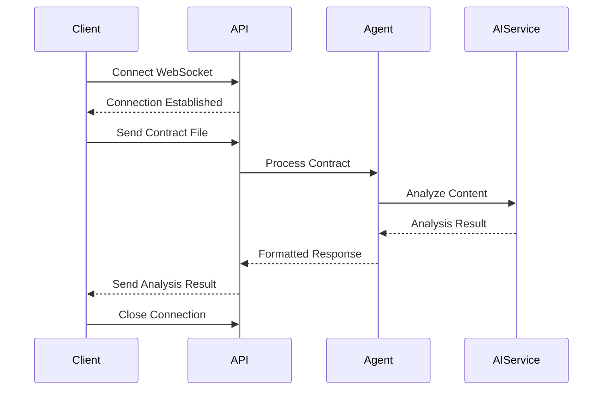

# API-Referenz

[← Zurück zur Hauptdokumentation](../README.md)

Dieses Dokument beschreibt alle API-Endpunkte im PocketLawyer-System. Alle Informationen werden aus dem tatsächlichen Quellcode in den Web/ und Infrastructure/ Verzeichnissen extrahiert.

## Inhaltsverzeichnis

- [Übersicht](#übersicht)
- [WebSocket-Endpunkte](#websocket-endpunkte)
- [HTTP-Endpunkte](#http-endpunkte)
- [Nachrichtenformate](#nachrichtenformate)
- [Fehlerbehandlung](#fehlerbehandlung)
- [Diagramme](#diagramme)

## Übersicht

Die PocketLawyer API bietet 2 WebSocket-Endpunkt(e) und 2 HTTP-Endpunkt(e) für Vertragsanalyse und Schema-Abruf.

### Basis-URL

Die API wird unter der Basis-URL der Anwendung gehostet. Standardmäßig ist dies:

- **Entwicklung:** `http://localhost:5112`
- **Produktion:** Konfiguriert über die Hosting-Umgebung

### Authentifizierung

Derzeit erfordert die API keine Authentifizierung. Dies kann sich in zukünftigen Versionen für Produktionsumgebungen ändern.

## WebSocket-Endpunkte

WebSocket-Endpunkte bieten Echtzeit-Vertragsanalyse. Clients verbinden sich über das WebSocket-Protokoll und senden Vertragsdateien zur Analyse.

### WebSocket: /employment-analysis

**Quelle:** `AnalyzeEmploymentViaWebSocket()` in `PocketController` (`Web/PocketController.cs`)

#### Verbindung

Verbinden zu: `ws://{host}/employment-analysis`

#### Nachrichtenformat

Senden Sie Vertragsdateien als WebSocket-Nachrichten im folgenden JSON-Format:

```json
{
  "fileName": "vertrag.pdf",
  "data": "<base64-encoded-file>",
  "contractType": "Employment"
}
```

`contractType` ist optional und wird aktuell nicht ausgewertet. Die Auswahl des Agents erfolgt über den Endpunkt.

#### Antwortformat

Antworttyp: WebSocket-JSON-Nachrichten. Die API sendet sequenziell:

```json
{ "type": "confirmation", "message": "Vertrag akzeptiert, Analyse gestartet" }
```

```json
{
  "type": "result",
  "data": {
    "result": { /* DTO für Basic oder Premium Analyse */ },
    "metadata": { /* AnalysisMetadataDto */ }
  }
}
```

```json
{ "type": "error", "error": "Fehlermeldung" }
```

Siehe Abschnitt [Nachrichtenformate](#nachrichtenformate) für Details.

#### Parameter


### WebSocket: /rental-analysis

**Quelle:** `AnalyzeRentalViaWebSocket()` in `PocketController` (`Web/PocketController.cs`)

#### Verbindung

Verbinden zu: `ws://{host}/rental-analysis`

#### Nachrichtenformat

Senden Sie Vertragsdateien als WebSocket-Nachrichten im folgenden JSON-Format:

```json
{
  "fileName": "vertrag.pdf",
  "data": "<base64-encoded-file>",
  "contractType": "Rental"
}
```

`contractType` ist optional und wird aktuell nicht ausgewertet. Die Auswahl des Agents erfolgt über den Endpunkt.

#### Antwortformat

Antworttyp: WebSocket-JSON-Nachrichten. Die API sendet sequenziell:

```json
{ "type": "confirmation", "message": "Vertrag akzeptiert, Analyse gestartet" }
```

```json
{
  "type": "result",
  "data": {
    "result": { /* DTO für Basic oder Premium Analyse */ },
    "metadata": { /* AnalysisMetadataDto */ }
  }
}
```

```json
{ "type": "error", "error": "Fehlermeldung" }
```

Siehe Abschnitt [Nachrichtenformate](#nachrichtenformate) für Details.

#### Parameter


## HTTP-Endpunkte

HTTP-Endpunkte bieten synchrone Operationen für Schema-Abruf und andere Hilfsfunktionen.

### GET Endpunkte

#### GET /api/schemas/{contractType}/{tier}/{step}

**Quelle:** `GetSchema()` in `PocketController` (`Web/PocketController.cs`)

##### Parameter

| Name | Typ | Quelle | Standard |
| --- | --- | --- | --- |
| contractType | string | FromRoute | - |
| tier | string | FromRoute | - |
| step | string | FromRoute | - |

##### Antwort

Gibt zurück: `ActionResult<object>`

##### Beispielanfrage

```http
GET /api/schemas/Employment/Basic/General HTTP/1.1
Host: localhost:5112
```


#### GET /employment-mockdata

**Quelle:** `GetMockData()` in `PocketController` (`Web/PocketController.cs`)

##### Antwort

Gibt zurück: `ActionResult<RentContractAnalysisDto>`

##### Beispielanfrage

```http
GET /employment-mockdata HTTP/1.1
Host: localhost:5112
```


## Nachrichtenformate

Dieser Abschnitt beschreibt die Datenstrukturen, die in API-Anfragen und -Antworten verwendet werden. Alle DTOs sind im Verzeichnis Domain/Dtos/ definiert.

Für vollständige DTO-Dokumentation siehe [DATA_MODELS.md](DATA_MODELS.md).

### Wichtige DTOs

#### AnalysisDto

**Namespace:** `PocketLawyer.Domain.Dtos.Shared`

**Eigenschaften:** (2)

  - `Result`: `TResult`
  - `Metadata`: `AnalysisMetadataDto`


#### ContractValidationDto

**Namespace:** `PocketLawyer.Domain.Dtos.Shared`

**Eigenschaften:** (4)

  - `IsReadable`: `bool`
  - `IsContract`: `bool`
  - `Result`: `string`
  - `Kollektivvertrag`: `string?`


#### EmploymentContractAnalysisDto

**Namespace:** `PocketLawyer.Domain.Dtos.Employment`

**Eigenschaften:** (9)

  - `ContractType`: `string`
  - `Tier`: `string`
  - `Keypoints`: `SummaryClass`
  - `UnzulaessigeKlauseln`: `ProblemKlausel[]`
  - `NachteileKlauseln`: `ProblemKlausel[]`
  - `WiderspruechlicheKlauseln`: `WiderspruechlicheKlausel[]`
  - `VorteilhafteKlauseln`: `VorteilKlausel[]`
  - `Fazit`: `string`
  - `Kollektivvertrag`: `string?`


#### FileContentDto

**Namespace:** `PocketLawyer.Domain.Dtos.Shared`

**Eigenschaften:** (2)

  - `FileName`: `string`
  - `FileContent`: `string`


#### RentContractAnalysisDto

**Namespace:** `PocketLawyer.Domain.Dtos.Rental`

**Eigenschaften:** (9)

  - `ContractType`: `string`
  - `Tier`: `string`
  - `Summary`: `Summary`
  - `UnzulaessigeKlauseln`: `ProblemKlausel[]`
  - `NachteileKlauseln`: `ProblemKlausel[]`
  - `WiderspruechlicheKlauseln`: `WiderspruechlicheKlausel[]`
  - `VorteilhafteKlauseln`: `VorteilKlausel[]`
  - `Fazit`: `string`
  - `Kollektivvertrag`: `string?`


#### WebSocketFileDto

**Namespace:** `PocketLawyer.Domain.Dtos.Shared`

**Eigenschaften:** (3)

  - `FileName`: `string`
  - `Data`: `string`
  - `ContractType`: `string?`


## Fehlerbehandlung

Die API verwendet Standard-HTTP-Statuscodes und benutzerdefinierte Exception-Typen für die Fehlerbehandlung. Alle benutzerdefinierten Exceptions sind im Verzeichnis Application/Exceptions/ definiert.

### HTTP-Statuscodes

| Statuscode | Beschreibung |
| --- | --- |
| 200 OK | Anfrage erfolgreich |
| 400 Bad Request | Ungültige Anfrageparameter oder fehlerhafte Daten |
| 404 Not Found | Angeforderte Ressource nicht gefunden |
| 500 Internal Server Error | Serverfehler während der Verarbeitung |

### Exception-Typen

Die folgenden benutzerdefinierten Exception-Typen können während API-Operationen auftreten:

#### AiServiceException

**Quelle:** `Application/Exceptions/AiServiceException.cs`

**Erbt von:** `Exception`


#### AnalysisException

**Quelle:** `Application/Exceptions/AnalysisException.cs`

**Erbt von:** `Exception`


#### ContractAnalysisException

**Quelle:** `Application/Exceptions/ContractAnalysisException.cs`

**Erbt von:** `Exception`


#### ContractValidationException

**Quelle:** `Application/Exceptions/ContractValidationException.cs`

**Erbt von:** `ContractAnalysisException`


#### FileValidationException

**Quelle:** `Application/Exceptions/FileValidationException.cs`

**Erbt von:** `Exception`


#### PromptNotFoundException

**Quelle:** `Application/Exceptions/PromptNotFoundException.cs`

**Erbt von:** `ContractAnalysisException`


#### SchemaNotFoundException

**Quelle:** `Application/Exceptions/SchemaNotFoundException.cs`

**Erbt von:** `ContractAnalysisException`


#### SchemaValidationException

**Quelle:** `Application/Exceptions/SchemaValidationException.cs`

**Erbt von:** `ContractAnalysisException`


#### UnsupportedContractTypeException

**Quelle:** `Application/Exceptions/UnsupportedContractTypeException.cs`

**Erbt von:** `ContractAnalysisException`


## Diagramme

### API-Endpunkt-Übersicht

Überblick über alle API-Endpunkte:

```mermaid
graph LR
    Client[Client Application]
    API[PocketLawyer API]
    
    Client -->|WebSocket| API
    Client -->|HTTP| API
    
    subgraph WebSocket Endpoints
        WS_employment_analysis[/employment-analysis]
        WS_rental_analysis[/rental-analysis]
    end
    
    subgraph HTTP Endpoints
        HTTP_api_schemas_contractType_tier_step[GET /api/schemas/{contractType}/{tier}/{step}]
        HTTP_employment_mockdata[GET /employment-mockdata]
    end
```

### WebSocket-Nachrichtenfluss

Typischer WebSocket-Interaktionsablauf:


