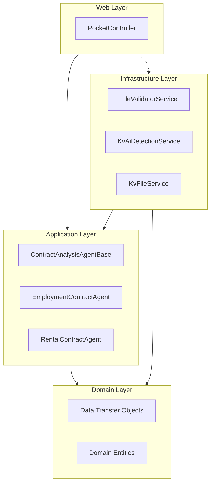
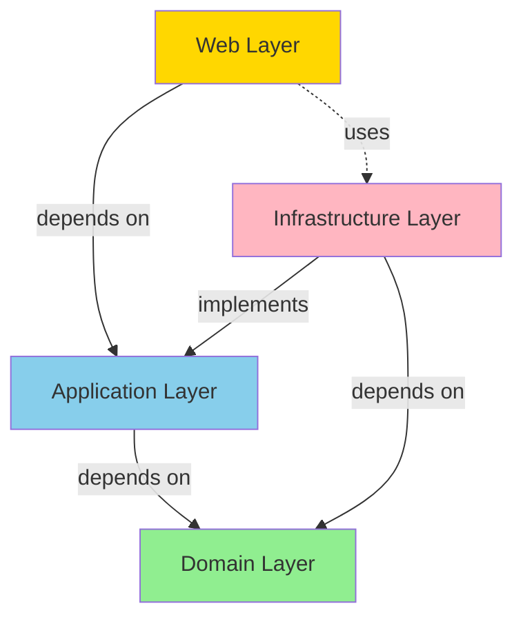
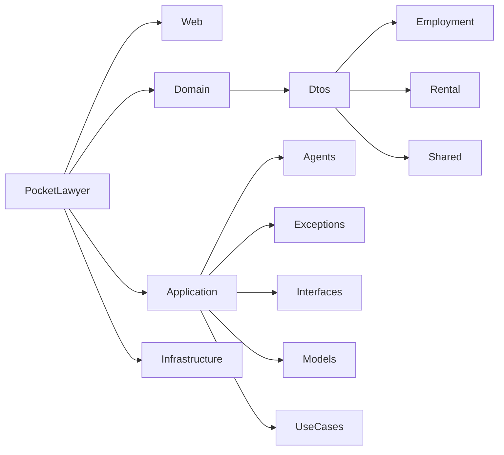

# Architektur

[← Zurück zur Hauptdokumentation](../README.md)

Dieses Dokument beschreibt die Architektur des PocketLawyer-Systems. Alle Informationen werden aus dem tatsächlichen Quellcode und der Ordnerstruktur extrahiert.

## Inhaltsverzeichnis

- [Übersicht](#übersicht)
- [Schichten](#schichten)
- [Abhängigkeiten](#abhängigkeiten)
- [Design Principles](#design-principles)
- [Diagramme](#diagramme)

## Übersicht

PocketLawyer folgt einem Onion-Architecture-Muster (auch bekannt als Clean Architecture). Das System ist in verschiedene Schichten mit klarer Trennung der Verantwortlichkeiten und Abhängigkeitsregeln organisiert.

### Architekturstil

Die Architektur folgt diesen Schlüsselprinzipien:

- **Onion Architecture:** Abhängigkeiten fließen nach innen zum Domain-Kern
- **Separation of Concerns:** Jede Schicht hat eine spezifische Verantwortung
- **Dependency Inversion:** High-Level-Module hängen nicht von Low-Level-Modulen ab
- **Domain-Centric:** Geschäftslogik ist in der Domain-Schicht isoliert

### Schichtenstruktur

Das System ist in vier Hauptschichten organisiert:

- **Domain-Schicht:** Kern-Geschäftsentitäten und DTOs (`Domain/`)
- **Application-Schicht:** Geschäftslogik und Use Cases (`Application/`)
- **Infrastructure-Schicht:** Externe Dienste und Implementierungen (`Infrastructure/`)
- **Web-Schicht:** API-Controller und Präsentationsschicht (`Web/`)

## Schichten

Each layer has specific responsibilities and dependencies. The following sections describe each layer in detail.

### Web Layer

The Web layer contains controllers and presentation logic. Located in `Web/`.

#### Key Components

##### Controllers

- `PocketController` in `Web/PocketController.cs`
  - `GetSchema()`
  - `GetMockData()`
  - `AnalyzeEmploymentViaWebSocket()`
  - `AnalyzeRentalViaWebSocket()`
##### Application Startup

Application configuration and dependency injection setup in `Web/Program.cs`.

### Application Layer

The Application layer contains business logic, use cases, and agents. Located in `Application/`.

#### Key Components

##### Contract Analysis Agents

Agents handle contract analysis workflows. Located in `Application/Agents/`.

- `ContractAnalysisAgentBase` in `Application/Agents/ContractAnalysisAgentBase.cs`
- `EmploymentContractAgent` in `Application/Agents/EmploymentContractAgent.cs`
- `RentalContractAgent` in `Application/Agents/RentalContractAgent.cs`
##### Exceptions

Custom exception types in `Application/Exceptions/`.

Total custom exceptions: 9

### Domain Layer

The Domain layer contains core business entities and Data Transfer Objects (DTOs). Located in `Domain/`.

#### Key Components

##### Data Transfer Objects (DTOs)

DTOs define the data structures used throughout the system. Located in `Domain/Dtos/`.

- Employment Contract DTOs: 13
- Rental Contract DTOs: 14
- Shared DTOs: 7

For complete DTO documentation, see [DATA_MODELS.md](DATA_MODELS.md).

##### Enumerations

Total enumerations: 3

### Infrastructure Layer

The Infrastructure layer contains implementations of external services and integrations. Located in `Infrastructure/`.

#### Key Components

##### AI Services

AI-Services befinden sich in `Infrastructure/AiServices/`:

- `NebiusService` in `Infrastructure/AiServices/Nebius/NebiusService.cs` - Primärer AI-Service für Vertragsanalyse
- `SchemaNameDetectionService` in `Infrastructure/AiServices/SchemaNameDetectionService.cs` - Erkennung von Schema-Namen
- `TimedAiClient` in `Infrastructure/AiServices/TimedAiClient.cs` - AI-Client mit Performance-Tracking

##### Weitere Services

- `FileValidatorService` in `Infrastructure/FileValidatorService.cs` - Validierung hochgeladener Dateien
- `KvAiDetectionService` in `Infrastructure/KvAiDetectionService.cs` - KI-basierte Kollektivvertrag-Erkennung
- `KvFileService` in `Infrastructure/KvFileService.cs` - Verwaltung von Kollektivvertrag-Dateien
- `FileDecoderService` in `Infrastructure/FileDecoding/FileDecoderService.cs` - Dekodierung verschiedener Dateiformate
##### Handlers

- `WebSocketAnalysisHandler` in `Infrastructure/WebSocketAnalysisHandler.cs`
##### Providers

- `ContextProvider` in `Infrastructure/Context/ContextProvider.cs`
- `SchemaProvider` in `Infrastructure/SchemaProviders/SchemaProvider.cs`
- `EmploymentBasicSummarySchemaProvider` in `Infrastructure/SchemaProviders/Employment/Basic/EmploymentBasicSummarySchemaProvider.cs`
- `EmploymentCompensationSchemaProvider` in `Infrastructure/SchemaProviders/Employment/Basic/EmploymentCompensationSchemaProvider.cs`
- `EmploymentGeneralSchemaProvider` in `Infrastructure/SchemaProviders/Employment/Basic/EmploymentGeneralSchemaProvider.cs`
- `EmploymentWorkingConditionsSchemaProvider` in `Infrastructure/SchemaProviders/Employment/Basic/EmploymentWorkingConditionsSchemaProvider.cs`
- `EmploymentClauseAnalysisSchemaProvider` in `Infrastructure/SchemaProviders/Employment/Premium/EmploymentClauseAnalysisSchemaProvider.cs`
- `EmploymentPremiumSummarySchemaProvider` in `Infrastructure/SchemaProviders/Employment/Premium/EmploymentPremiumSummarySchemaProvider.cs`
- `RentalBasicSummarySchemaProvider` in `Infrastructure/SchemaProviders/Rental/Basic/RentalBasicSummarySchemaProvider.cs`
- `RentalContractConditionsSchemaProvider` in `Infrastructure/SchemaProviders/Rental/Basic/RentalContractConditionsSchemaProvider.cs`
- `RentalGeneralSchemaProvider` in `Infrastructure/SchemaProviders/Rental/Basic/RentalGeneralSchemaProvider.cs`
- `RentalRentConditionsSchemaProvider` in `Infrastructure/SchemaProviders/Rental/Basic/RentalRentConditionsSchemaProvider.cs`
- `ClauseAnalysisSchemaProvider` in `Infrastructure/SchemaProviders/Rental/Premium/ClauseAnalysisSchemaProvider.cs`
- `RentalPremiumSummarySchemaProvider` in `Infrastructure/SchemaProviders/Rental/Premium/RentalPremiumSummarySchemaProvider.cs`
## Abhängigkeiten

The architecture follows strict dependency rules. Dependencies flow inward toward the domain core.

### Dependency Rules

- **Domain Layer:** Has no dependencies on other layers (pure business logic)
- **Application Layer:** Depends only on Domain layer
- **Infrastructure Layer:** Depends on Application and Domain layers
- **Web Layer:** Depends on Application, Domain, and Infrastructure layers

### Actual Dependencies

The following dependencies are extracted from actual using statements in the source code:

#### Web Layer Dependencies

- `PocketLawyer.Application.Agents` (referenced 2 time(s))
- `PocketLawyer.Application.Exceptions` (referenced 1 time(s))
- `PocketLawyer.Application.Interfaces` (referenced 2 time(s))
- `PocketLawyer.Domain.Dtos.Rental` (referenced 1 time(s))
- `PocketLawyer.Domain.Dtos.Shared` (referenced 1 time(s))
- `PocketLawyer.Infrastructure` (referenced 2 time(s))
- `PocketLawyer.Infrastructure.AiServices.Nebius` (referenced 1 time(s))
- `PocketLawyer.Infrastructure.Context` (referenced 1 time(s))
- `PocketLawyer.Infrastructure.FileDecoding` (referenced 1 time(s))
- `PocketLawyer.Infrastructure.Logging` (referenced 1 time(s))
- `PocketLawyer.Infrastructure.SchemaProviders` (referenced 1 time(s))
- `PocketLawyer.Options` (referenced 2 time(s))

#### Application Layer Dependencies

- `PocketLawyer.Application.Interfaces` (referenced 4 time(s))
- `PocketLawyer.Application.Models` (referenced 5 time(s))
- `PocketLawyer.Domain` (referenced 1 time(s))
- `PocketLawyer.Domain.Dtos.Employment` (referenced 1 time(s))
- `PocketLawyer.Domain.Dtos.Rental` (referenced 2 time(s))
- `PocketLawyer.Domain.Dtos.Shared` (referenced 9 time(s))
- `PocketLawyer.Infrastructure.Context` (referenced 2 time(s))
- `PocketLawyer.Options` (referenced 1 time(s))

#### Infrastructure Layer Dependencies

- `PocketLawyer.Application.Agents` (referenced 1 time(s))
- `PocketLawyer.Application.Exceptions` (referenced 6 time(s))
- `PocketLawyer.Application.Interfaces` (referenced 25 time(s))
- `PocketLawyer.Application.Models` (referenced 5 time(s))
- `PocketLawyer.Domain` (referenced 1 time(s))
- `PocketLawyer.Domain.Dtos.Employment` (referenced 5 time(s))
- `PocketLawyer.Domain.Dtos.Rental` (referenced 7 time(s))
- `PocketLawyer.Domain.Dtos.Shared` (referenced 16 time(s))
- `PocketLawyer.Infrastructure.AiServices.Gemini.Models` (referenced 2 time(s))
- `PocketLawyer.Infrastructure.AiServices.Nebius` (referenced 1 time(s))
- `PocketLawyer.Infrastructure.SchemaProviders.Employment.Basic` (referenced 1 time(s))
- `PocketLawyer.Infrastructure.SchemaProviders.Employment.Premium` (referenced 1 time(s))
- `PocketLawyer.Infrastructure.SchemaProviders.Rental.Basic` (referenced 1 time(s))
- `PocketLawyer.Infrastructure.SchemaProviders.Rental.Premium` (referenced 1 time(s))
- `PocketLawyer.Options` (referenced 10 time(s))

#### Domain Layer Dependencies

- `PocketLawyer.Application.Exceptions` (referenced 1 time(s))
- `PocketLawyer.Domain.Dtos.Rental` (referenced 1 time(s))
- `PocketLawyer.Domain.Dtos.Shared` (referenced 6 time(s))
- `PocketLawyer.Infrastructure.SchemaProviders` (referenced 4 time(s))

## Design Principles

The system follows established software design principles. The following principles are demonstrated in the actual codebase:

### SOLID Principles

#### Single Responsibility Principle (SRP)

Each class has a single, well-defined responsibility.

**Examples:**

- `PromptProvider` in `Domain/PromptProvider.cs` - Handles data/resource provision
- `FileValidatorService` in `Infrastructure/FileValidatorService.cs` - Handles service operations
- `KvAiDetectionService` in `Infrastructure/KvAiDetectionService.cs` - Handles service operations
#### Dependency Inversion Principle (DIP)

High-level modules depend on abstractions (interfaces), not concrete implementations.

**Examples:**

- `IAiClient` in `Application/Interfaces/IAiClient.cs` - Interface for abstraction
- `IContextFileReader` in `Application/Interfaces/IContextFileReader.cs` - Interface for abstraction
- `IContextProvider` in `Application/Interfaces/IContextProvider.cs` - Interface for abstraction
#### Interface Segregation Principle (ISP)

Interfaces are focused and specific to client needs.

**Examples:**

- `IAiClient` in `Application/Interfaces/IAiClient.cs` - Focused interface with 2 method(s)
- `IContextFileReader` in `Application/Interfaces/IContextFileReader.cs` - Focused interface with 1 method(s)
### DRY (Don't Repeat Yourself)

Common functionality is extracted into reusable components.

**Examples:**

- `ContractAnalysisAgentBase` in `Application/Agents/ContractAnalysisAgentBase.cs` - Abstract base class for code reuse
- `WebSocketHelpers` in `Infrastructure/WebSocketHelpers.cs` - Utility class for code reuse
### YAGNI (You Aren't Gonna Need It)

The system implements only the features that are currently needed, avoiding speculative generality and unnecessary complexity.

This principle is demonstrated through focused, purpose-driven classes that solve specific problems without over-engineering.

## Diagrams

### Layered Component Diagram

High-level view of the system's layered architecture:

### Dependency Graph

Dependency flow between layers:

### Package Structure

Organization of namespaces and packages:

