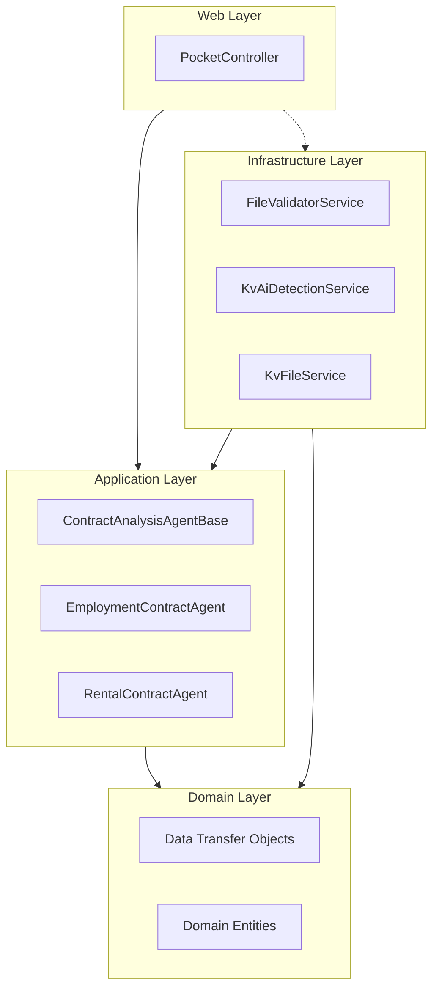
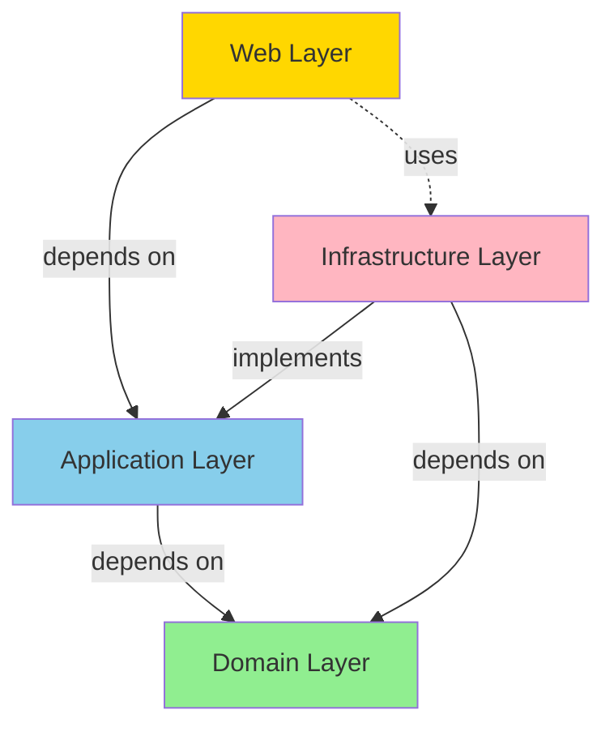
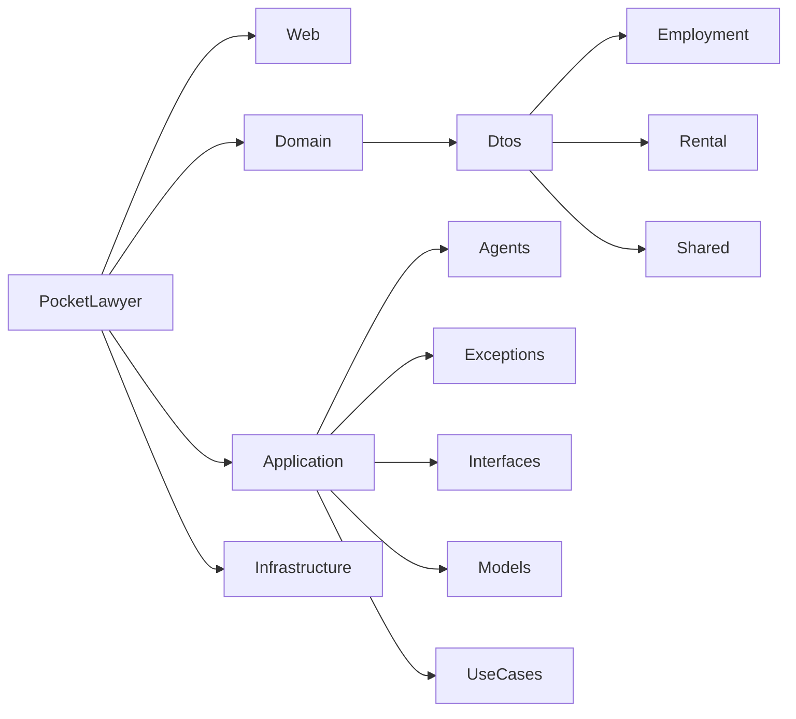

# Architektur

[← Zurück zur Hauptdokumentation](../README.md)

Dieses Dokument beschreibt die Architektur des PocketLawyer-Systems. Alle Informationen werden aus dem tatsächlichen Quellcode und der Ordnerstruktur extrahiert.

## Inhaltsverzeichnis

- [Übersicht](#übersicht)
- [Schichten](#schichten)
- [Abhängigkeiten](#abhängigkeiten)
- [Designprinzipien](#designprinzipien)
- [Diagramme](#diagramme)

## Übersicht

PocketLawyer folgt einem Onion-Architecture-Muster (auch bekannt als Clean Architecture). Das System ist in verschiedene Schichten mit klarer Trennung der Verantwortlichkeiten und Abhängigkeitsregeln organisiert.

### Architekturstil

Die Architektur folgt diesen Schlüsselprinzipien:

- **Onion Architecture:** Abhängigkeiten fließen nach innen zum Domain-Kern
- **Separation of Concerns:** Jede Schicht hat eine spezifische Verantwortung
- **Dependency Inversion:** High-Level-Module hängen nicht von Low-Level-Modulen ab
- **Domain-Centric:** Geschäftslogik ist in der Domain-Schicht isoliert

### Schichtenstruktur

Das System ist in vier Hauptschichten organisiert:

- **Domain-Schicht:** Kern-Geschäftsentitäten und DTOs (`Domain/`)
- **Application-Schicht:** Geschäftslogik und Use Cases (`Application/`)
- **Infrastructure-Schicht:** Externe Dienste und Implementierungen (`Infrastructure/`)
- **Web-Schicht:** API-Controller und Präsentationsschicht (`Web/`)

## Schichten

Jede Schicht hat klar definierte Verantwortlichkeiten und Abhängigkeiten. Die folgenden Abschnitte beschreiben die Schichten im Detail.

### Web-Schicht

Die Web-Schicht enthält Controller und Präsentationslogik. Sie befindet sich in `Web/`.

#### Zentrale Komponenten

##### Controller

- `PocketController` in `Web/PocketController.cs`
  - `GetSchema()`
  - `GetEmploymentMockData()`
  - `GetRentalMockData()`
  - `AnalyzeEmploymentViaWebSocket()`
  - `AnalyzeRentalViaWebSocket()`
##### Anwendungsstart

Konfiguration der Anwendung und Dependency Injection in `Web/Program.cs`.

### Application-Schicht

Die Application-Schicht enthält Geschäftslogik, Use Cases und Agents. Sie befindet sich in `Application/`.

#### Zentrale Komponenten

##### Contract-Analysis-Agents

Agents steuern die Vertragsanalyse-Workflows. Sie befinden sich in `Application/Agents/`.

- `ContractAnalysisAgentBase` in `Application/Agents/ContractAnalysisAgentBase.cs`
- `EmploymentContractAgent` in `Application/Agents/EmploymentContractAgent.cs`
- `RentalContractAgent` in `Application/Agents/RentalContractAgent.cs`
##### Exceptions

Benutzerdefinierte Exception-Typen in `Application/Exceptions/`.

Anzahl benutzerdefinierter Exceptions: 9

### Domain-Schicht

Die Domain-Schicht enthält die Kerngeschäftsentitäten und Data Transfer Objects (DTOs). Sie befindet sich in `Domain/`.

#### Zentrale Komponenten

##### Data Transfer Objects (DTOs)

DTOs definieren die Datenstrukturen des Systems. Sie befinden sich in `Domain/Dtos/`.

- Employment DTOs: 3
- Rental DTOs: 3
- Shared DTOs und Interfaces: 8

Für die vollständige DTO-Dokumentation siehe [DATA_MODELS.md](DATA_MODELS.md).

##### Enumerations

Anzahl Enumerationen: 2

### Infrastructure-Schicht

Die Infrastructure-Schicht enthält Implementierungen externer Dienste und Integrationen. Sie befindet sich in `Infrastructure/`.

#### Zentrale Komponenten

##### AI Services

AI-Services befinden sich in `Infrastructure/AiServices/`:

- `NebiusService` in `Infrastructure/AiServices/Nebius/NebiusService.cs` - Primärer AI-Service für Vertragsanalyse
- `SchemaNameDetectionService` in `Infrastructure/AiServices/SchemaNameDetectionService.cs` - Erkennung von Schema-Namen
- `TimedAiClient` in `Infrastructure/AiServices/TimedAiClient.cs` - AI-Client mit Performance-Tracking

##### Weitere Services

- `FileValidatorService` in `Infrastructure/FileValidatorService.cs` - Validierung hochgeladener Dateien
- `KvAiDetectionService` in `Infrastructure/KvAiDetectionService.cs` - KI-basierte Kollektivvertrag-Erkennung
- `KvFileService` in `Infrastructure/KvFileService.cs` - Verwaltung von Kollektivvertrag-Dateien
- `FileDecoderService` in `Infrastructure/FileDecoding/FileDecoderService.cs` - Dekodierung verschiedener Dateiformate
##### Handlers

- `WebSocketAnalysisHandler` in `Infrastructure/WebSocketAnalysisHandler.cs`
##### Providers

- `ContextProvider` in `Infrastructure/Context/ContextProvider.cs`
- `SchemaProvider` in `Infrastructure/SchemaProviders/SchemaProvider.cs`
- `EmploymentBasicSummarySchemaProvider` in `Infrastructure/SchemaProviders/Employment/Basic/EmploymentBasicSummarySchemaProvider.cs`
- `EmploymentCompensationSchemaProvider` in `Infrastructure/SchemaProviders/Employment/Basic/EmploymentCompensationSchemaProvider.cs`
- `EmploymentGeneralSchemaProvider` in `Infrastructure/SchemaProviders/Employment/Basic/EmploymentGeneralSchemaProvider.cs`
- `EmploymentWorkingConditionsSchemaProvider` in `Infrastructure/SchemaProviders/Employment/Basic/EmploymentWorkingConditionsSchemaProvider.cs`
- `EmploymentClauseAnalysisSchemaProvider` in `Infrastructure/SchemaProviders/Employment/Premium/EmploymentClauseAnalysisSchemaProvider.cs`
- `EmploymentPremiumSummarySchemaProvider` in `Infrastructure/SchemaProviders/Employment/Premium/EmploymentPremiumSummarySchemaProvider.cs`
- `RentalBasicSummarySchemaProvider` in `Infrastructure/SchemaProviders/Rental/Basic/RentalBasicSummarySchemaProvider.cs`
- `RentalContractConditionsSchemaProvider` in `Infrastructure/SchemaProviders/Rental/Basic/RentalContractConditionsSchemaProvider.cs`
- `RentalGeneralSchemaProvider` in `Infrastructure/SchemaProviders/Rental/Basic/RentalGeneralSchemaProvider.cs`
- `RentalRentConditionsSchemaProvider` in `Infrastructure/SchemaProviders/Rental/Basic/RentalRentConditionsSchemaProvider.cs`
- `ClauseAnalysisSchemaProvider` in `Infrastructure/SchemaProviders/Rental/Premium/ClauseAnalysisSchemaProvider.cs`
- `RentalPremiumSummarySchemaProvider` in `Infrastructure/SchemaProviders/Rental/Premium/RentalPremiumSummarySchemaProvider.cs`
## Abhängigkeiten

Die Architektur folgt klaren Abhängigkeitsregeln. Die folgenden Regeln beschreiben den Zielzustand; die tatsächlichen Abhängigkeiten darunter zeigen, wo es aktuell Abweichungen gibt.

### Abhängigkeitsregeln

- **Domain-Schicht:** Sollte keine Abhängigkeiten zu anderen Schichten haben (reine Geschäftslogik)
- **Application-Schicht:** Hängt nur von der Domain-Schicht ab
- **Infrastructure-Schicht:** Hängt von Application- und Domain-Schicht ab
- **Web-Schicht:** Hängt von Application-, Domain- und Infrastructure-Schicht ab

### Tatsächliche Abhängigkeiten

Die folgenden Abhängigkeiten werden aus den tatsächlichen using-Statements im Quellcode abgeleitet:

**Hinweis:** In der Domain-Schicht gibt es derzeit Abhängigkeiten zu Application- und Infrastructure-Typen (siehe unten). Das weicht vom angestrebten Dependency-Rule-Ziel ab und sollte bei einer Architekturbereinigung berücksichtigt werden.

#### Web-Schicht-Abhängigkeiten

- `PocketLawyer.Application.Agents` (referenced 2 time(s))
- `PocketLawyer.Application.Exceptions` (referenced 1 time(s))
- `PocketLawyer.Application.Interfaces` (referenced 2 time(s))
- `PocketLawyer.Domain.Dtos.Rental` (referenced 1 time(s))
- `PocketLawyer.Domain.Dtos.Shared` (referenced 1 time(s))
- `PocketLawyer.Infrastructure` (referenced 2 time(s))
- `PocketLawyer.Infrastructure.AiServices.Nebius` (referenced 1 time(s))
- `PocketLawyer.Infrastructure.Context` (referenced 1 time(s))
- `PocketLawyer.Infrastructure.FileDecoding` (referenced 1 time(s))
- `PocketLawyer.Infrastructure.Logging` (referenced 1 time(s))
- `PocketLawyer.Infrastructure.SchemaProviders` (referenced 1 time(s))
- `PocketLawyer.Options` (referenced 2 time(s))

#### Application-Schicht-Abhängigkeiten

- `PocketLawyer.Application.Interfaces` (referenced 4 time(s))
- `PocketLawyer.Application.Models` (referenced 5 time(s))
- `PocketLawyer.Domain` (referenced 1 time(s))
- `PocketLawyer.Domain.Dtos.Employment` (referenced 1 time(s))
- `PocketLawyer.Domain.Dtos.Rental` (referenced 2 time(s))
- `PocketLawyer.Domain.Dtos.Shared` (referenced 9 time(s))
- `PocketLawyer.Infrastructure.Context` (referenced 2 time(s))
- `PocketLawyer.Options` (referenced 1 time(s))

#### Infrastructure-Schicht-Abhängigkeiten

- `PocketLawyer.Application.Agents` (referenced 1 time(s))
- `PocketLawyer.Application.Exceptions` (referenced 6 time(s))
- `PocketLawyer.Application.Interfaces` (referenced 25 time(s))
- `PocketLawyer.Application.Models` (referenced 5 time(s))
- `PocketLawyer.Domain` (referenced 1 time(s))
- `PocketLawyer.Domain.Dtos.Employment` (referenced 5 time(s))
- `PocketLawyer.Domain.Dtos.Rental` (referenced 7 time(s))
- `PocketLawyer.Domain.Dtos.Shared` (referenced 16 time(s))
- `PocketLawyer.Infrastructure.AiServices.Gemini.Models` (referenced 2 time(s))
- `PocketLawyer.Infrastructure.AiServices.Nebius` (referenced 1 time(s))
- `PocketLawyer.Infrastructure.SchemaProviders.Employment.Basic` (referenced 1 time(s))
- `PocketLawyer.Infrastructure.SchemaProviders.Employment.Premium` (referenced 1 time(s))
- `PocketLawyer.Infrastructure.SchemaProviders.Rental.Basic` (referenced 1 time(s))
- `PocketLawyer.Infrastructure.SchemaProviders.Rental.Premium` (referenced 1 time(s))
- `PocketLawyer.Options` (referenced 10 time(s))

#### Domain-Schicht-Abhängigkeiten

- `PocketLawyer.Application.Exceptions` (referenced 1 time(s))
- `PocketLawyer.Domain.Dtos.Rental` (referenced 1 time(s))
- `PocketLawyer.Domain.Dtos.Shared` (referenced 6 time(s))
- `PocketLawyer.Infrastructure.SchemaProviders` (referenced 4 time(s))

## Designprinzipien

Das System folgt etablierten Software-Design-Prinzipien. Die folgenden Prinzipien sind im Code nachvollziehbar umgesetzt:

### SOLID-Prinzipien

#### Single Responsibility Principle (SRP)

Jede Klasse hat eine klar definierte Verantwortung.

**Beispiele:**

- `PromptProvider` in `Domain/PromptProvider.cs` - Stellt Daten/Prompts bereit
- `FileValidatorService` in `Infrastructure/FileValidatorService.cs` - Validiert und dekodiert Dateien
- `KvAiDetectionService` in `Infrastructure/KvAiDetectionService.cs` - Führt die KV-Erkennung aus
#### Dependency Inversion Principle (DIP)

High-Level-Module hängen von Abstraktionen (Interfaces) ab, nicht von konkreten Implementierungen.

**Beispiele:**

- `IAiClient` in `Application/Interfaces/IAiClient.cs` - Abstraktion des AI-Clients
- `IContextFileReader` in `Application/Interfaces/IContextFileReader.cs` - Abstraktion für das Lesen von Kontextdateien
- `IContextProvider` in `Application/Interfaces/IContextProvider.cs` - Abstraktion für Kontextbereitstellung
#### Interface Segregation Principle (ISP)

Interfaces sind fokussiert und auf die Bedürfnisse der aufrufenden Komponenten zugeschnitten.

**Beispiele:**

- `IAiClient` in `Application/Interfaces/IAiClient.cs` - Fokussiertes Interface mit 2 Methoden
- `IContextFileReader` in `Application/Interfaces/IContextFileReader.cs` - Fokussiertes Interface mit 1 Methode
### DRY (Don't Repeat Yourself)

Gemeinsame Funktionalität wird in wiederverwendbare Komponenten ausgelagert.

**Beispiele:**

- `ContractAnalysisAgentBase` in `Application/Agents/ContractAnalysisAgentBase.cs` - Abstrakte Basisklasse zur Wiederverwendung
- `WebSocketHelpers` in `Infrastructure/WebSocketHelpers.cs` - Hilfsklasse zur Wiederverwendung
### YAGNI (You Aren't Gonna Need It)

Das System implementiert nur die derzeit benötigten Funktionen und vermeidet spekulative Allgemeinheit sowie unnötige Komplexität.

Das zeigt sich in fokussierten, zweckgebundenen Klassen, die konkrete Probleme ohne Over-Engineering lösen.

## Diagramme

### Schichtenübersicht

Übersicht der Schichtenarchitektur:

### Abhängigkeitsgraf

Abhängigkeitsfluss zwischen den Schichten:

### Paketstruktur

Organisation der Namespaces und Pakete:

