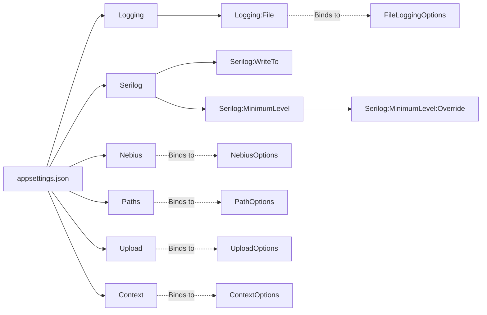

# Konfiguration

[← Zurück zur Hauptdokumentation](../README.md)

Dieses Dokument beschreibt alle Konfigurationsoptionen für das PocketLawyer-System. Alle Informationen werden aus den tatsächlichen Konfigurationsdateien und Options-Klassen extrahiert.

## Inhaltsverzeichnis

- [Übersicht](#übersicht)
- [appsettings.json Struktur](#appsettingsjson-struktur)
- [Logging-Konfiguration](#logging-konfiguration)
- [KI-Dienste-Konfiguration](#ki-dienste-konfiguration)
- [Pfad-Konfiguration](#pfad-konfiguration)
- [Upload-Konfiguration](#upload-konfiguration)
- [Kontext-Konfiguration](#kontext-konfiguration)
- [Weitere Options-Klassen](#weitere-options-klassen)
- [User Secrets](#user-secrets)
- [Umgebungsvariablen](#umgebungsvariablen)
- [Diagramme](#diagramme)

## Übersicht

PocketLawyer verwendet zwei Konfigurationsdateien und fünf Options-Klassen, um Anwendungseinstellungen zu verwalten. Die Konfiguration folgt dem ASP.NET-Core-Muster mit stark typisierten Options-Klassen, die an Konfigurationsabschnitte gebunden werden.

### Konfigurationsdateien

Die folgenden Konfigurationsdateien werden verwendet:

- `appsettings.Development.json` - Development environment overrides
- `appsettings.json` - Base configuration for all environments

### Options-Klassen

Die Konfiguration wird auf die folgenden stark typisierten Options-Klassen abgebildet:

- `ContextOptions` - `Options/ContextOptions.cs`
- `FileLoggingOptions` - `Options/FileLoggingOptions.cs`
- `NebiusOptions` - `Options/NebiusOptions.cs`
- `PathOptions` - `Options/PathOptions.cs`
- `UploadOptions` - `Options/UploadOptions.cs`

## appsettings.json Struktur

Die Struktur der Hauptkonfigurationsdatei mit allen verfügbaren Abschnitten und Schlüsseln.

**Source:** `appsettings.json`

### Context

| Key | Type | Value | Beschreibung |
| --- | --- | --- | --- |
| BasePath | string | data/Context | Basispfad für Kontextdateien |
| CreateReadmeFiles | bool | true | Automatische Erstellung von README-Dateien in Kontextverzeichnissen |
| MaxContextSizeBytes | long | 5242880 | Maximale Größe der Kontextdateien in Bytes (5 MB) |
| IncludeKvContentInAnalysis | bool | false | **Wichtig:** Wenn `true`, wird der vollständige Kollektivvertrag-Text in die Analyse einbezogen. Dies erhöht die Token-Nutzung erheblich, kann aber die Analysequalität verbessern. In `appsettings.json` ist der Wert `false` (nur KV-Name wird verwendet). Der Default in `ContextOptions` ist `true`, falls keine Konfiguration gesetzt ist. |

### Logging:File

| Key | Type | Value |
| --- | --- | --- |
| Enabled | bool | true |
| MinimumLevel | string | Information |
| Path | string | logs |

### Logging

*No direct keys in this section. See nested sections.*

### Serilog:MinimumLevel

| Key | Type | Value |
| --- | --- | --- |
| Default | string | Information |

### Nebius

| Key | Type | Value |
| --- | --- | --- |
| ModelId | string | meta-llama/Llama-3.3-70B-Instruct |

### Serilog:MinimumLevel:Override

| Key | Type | Value |
| --- | --- | --- |
| Microsoft.AspNetCore | string | Warning |
| Microsoft.AspNetCore.Hosting | string | Warning |
| Microsoft.AspNetCore.Routing | string | Warning |
| Microsoft.AspNetCore.Mvc | string | Warning |
| Microsoft.AspNetCore.StaticFiles | string | Warning |
| Microsoft.Extensions.Http | string | Warning |
| System.Net.Http.HttpClient | string | Warning |

### Paths

| Key | Type | Value |
| --- | --- | --- |
| ResponsesPath | string | data/Responses |
| TesseractDataPath | string | data/tessdata |
| KVSPath | string | data/KVS/Employment |

### Serilog

| Key | Type | Value |
| --- | --- | --- |
| WriteTo | array | [
            {
                "Name": "Console"
            }
        ] |

### Upload

| Key | Type | Value |
| --- | --- | --- |
| MaxUploadSizeMB | long | 20 |

### Root Level Keys

| Key | Type | Value |
| --- | --- | --- |
| AllowedHosts | string | * |

## Logging-Konfiguration

Konfiguration für das Anwendungs-Logging, einschließlich Datei-Logging und Log-Leveln.

**Configuration Section:** `Logging`

### Logging:File

| Category | Level |
| --- | --- |
| Enabled | true |
| MinimumLevel | Information |
| Path | logs |

## KI-Dienste-Konfiguration

Konfiguration für den Nebius AI-Service, der für die Vertragsanalyse verwendet wird.

### NebiusOptions

**Source:** `NebiusOptions` (namespace: `PocketLawyer.Options`) in `Options/NebiusOptions.cs`

#### Properties

| Property | Type | Configuration Key | Default Value |
| --- | --- | --- | --- |
| Key | string | - | "" |
| ModelId | string | - | "" |


## Pfad-Konfiguration

Konfiguration für Dateisystempfade, die von der Anwendung verwendet werden.

### PathOptions

**Source:** `PathOptions` (namespace: `PocketLawyer.Options`) in `Options/PathOptions.cs`

#### Properties

| Property | Type | Configuration Key | Default Value |
| --- | --- | --- | --- |
| ResponsesPath | string | - | data/Responses |
| TesseractDataPath | string | - | data/tessdata |
| KVSPath | string | - | data/KVS |


## Upload-Konfiguration

Konfiguration für Datei-Upload-Limits und Einschränkungen.

### UploadOptions

**Source:** `UploadOptions` (namespace: `PocketLawyer.Options`) in `Options/UploadOptions.cs`

#### Properties

| Property | Type | Configuration Key | Default Value |
| --- | --- | --- | --- |
| MaxUploadSizeMB | long | - | 20 |


## Kontext-Konfiguration

Konfiguration für KI-Kontextdateien und Prompts.

### ContextOptions

**Source:** `ContextOptions` (namespace: `PocketLawyer.Options`) in `Options/ContextOptions.cs`

#### Properties

| Property | Type | Configuration Key | Default Value |
| --- | --- | --- | --- |
| BasePath | string | - | data/Context |
| CreateReadmeFiles | bool | - | true |
| MaxContextSizeBytes | long | - | 5242880 |
| IncludeKvContentInAnalysis | bool | - | true |


## Weitere Options-Klassen

Zusätzliche Konfigurations-Options-Klassen.

### FileLoggingOptions

**Source:** `FileLoggingOptions` (namespace: `PocketLawyer.Options`) in `Options/FileLoggingOptions.cs`

#### Properties

| Property | Type | Configuration Key | Default Value |
| --- | --- | --- | --- |
| Enabled | bool | - | true |
| MinimumLevel | string | - | Information |
| Path | string | - | logs |


## User Secrets

Für die Entwicklung sollten sensible Konfigurationswerte (z. B. API-Schlüssel) in User Secrets statt in appsettings.json-Dateien gespeichert werden.

### User Secrets setzen

Verwenden Sie die .NET-CLI, um User Secrets zu verwalten:

```bash
dotnet user-secrets init
dotnet user-secrets set "Nebius:Key" "your-api-key-here"
```

### User Secrets auflisten

```bash
dotnet user-secrets list
```

### User Secrets entfernen

```bash
dotnet user-secrets remove "Nebius:Key"
dotnet user-secrets clear  # Remove all secrets
```

## Umgebungsvariablen

Konfiguration kann auch über Umgebungsvariablen bereitgestellt werden. Umgebungsvariablen überschreiben Werte aus appsettings.json und User Secrets.

### Format

Verwenden Sie doppelte Unterstriche (__) zur Abbildung der Konfigurationshierarchie:

```bash
Nebius__Key=your-api-key
Paths__ResponsesPath=/app/responses
Context__BasePath=/app/context
Logging__LogLevel__Default=Information
```

### Umgebungsvariablen setzen

#### Windows (PowerShell)

```powershell
$env:Nebius__Key="your-api-key"
$env:ASPNETCORE_ENVIRONMENT="Production"
```

#### Linux/macOS

```bash
export Nebius__Key="your-api-key"
export ASPNETCORE_ENVIRONMENT="Production"
```

#### Docker

```bash
docker run -e Nebius__Key="your-api-key" -e ASPNETCORE_ENVIRONMENT="Production" pocketlawyer
```

## Diagrams

### Configuration Hierarchy

Overview of configuration sources and their precedence:

```mermaid
graph TD
    A[Application Configuration] --> B[appsettings.json]
    A --> C[appsettings.{Environment}.json]
    A --> D[User Secrets]
    A --> E[Environment Variables]
    A --> F[Command Line Arguments]
    
    B -.->|Lowest Priority| G[Final Configuration]
    C -.->|Overrides| G
    D -.->|Overrides| G
    E -.->|Overrides| G
    F -.->|Highest Priority| G
    
    G --> H[Strongly-Typed Options]
    H --> I[Application Code]
```

### Configuration to Options Mapping

Mapping between configuration sections and option classes:


