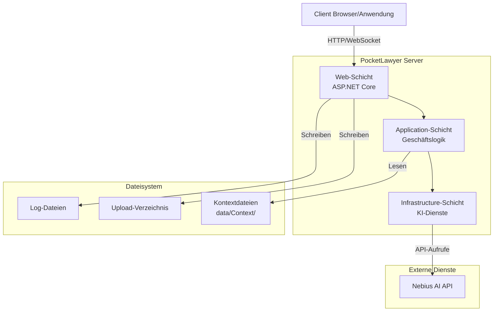
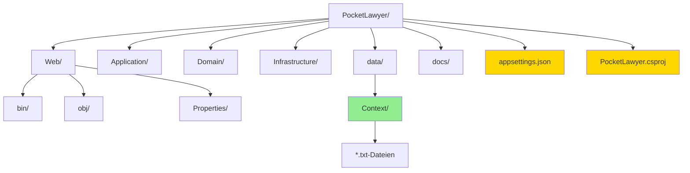

# Deployment

[← Zurück zur Hauptdokumentation](../README.md)

Dieses Dokument bietet Deployment- und Setup-Anleitungen für das PocketLawyer-System. Alle Informationen werden aus den tatsächlichen Projektdateien und der Verzeichnisstruktur extrahiert.

## Inhaltsverzeichnis

- [Systemanforderungen](#systemanforderungen)
- [Installation](#installation)
- [Konfiguration](#konfiguration)
- [Kontextdateien](#kontextdateien)
- [Anwendung ausführen](#anwendung-ausfuehren)
- [Health Checks](#health-checks)
- [Fehlerbehebung](#fehlerbehebung)
- [Diagramme](#diagramme)

## Systemanforderungen

Die folgende Software und Abhängigkeiten sind erforderlich, um PocketLawyer auszuführen:

### .NET SDK

**Erforderliche Version:** .NET 8.0 SDK oder höher

**Quelle:** `PocketLawyer.csproj` (TargetFramework: `net8.0`)

#### .NET SDK herunterladen

Laden Sie das .NET SDK von der offiziellen Microsoft-Website herunter:

- [.NET Downloads](https://dotnet.microsoft.com/download)

#### Installation überprüfen

Überprüfen Sie nach der Installation die .NET SDK-Version:

```bash
dotnet --version
```

### Betriebssystem

PocketLawyer kann auf jedem Betriebssystem ausgeführt werden, das .NET unterstützt:

- Windows 10/11 oder Windows Server 2016+
- macOS 10.15 (Catalina) oder höher
- Linux (Ubuntu 20.04+, Debian 10+, RHEL 8+ oder gleichwertig)

### Hardware-Anforderungen

Minimale Hardware-Anforderungen:

- **CPU:** 2 Kerne oder mehr
- **RAM:** 4 GB Minimum, 8 GB empfohlen
- **Festplattenspeicher:** 500 MB für die Anwendung, zusätzlicher Speicher für hochgeladene Dateien und Logs

### Abhängigkeiten

Die folgenden NuGet-Pakete sind erforderlich und werden automatisch wiederhergestellt:

| Paket | Version | Zweck |
| --- | --- | --- |
| Anthropic.SDK | 5.4.1 | Anwendungsabhängigkeit |
| Google_GenerativeAI | 2.7.0 | Anwendungsabhängigkeit |
| Microsoft.CodeAnalysis.CSharp | 4.8.0 | Anwendungsabhängigkeit |
| Microsoft.CodeAnalysis.CSharp.Workspaces | 4.8.0 | Anwendungsabhängigkeit |
| NJsonSchema | 11.5.2 | Anwendungsabhängigkeit |
| OpenAI | 2.7.0 | Anwendungsabhängigkeit |
| PdfPig | 0.1.12 | Anwendungsabhängigkeit |
| Scrutor | 7.0.0 | Anwendungsabhängigkeit |
| Serilog.AspNetCore | 10.0.0 | Logging-Framework |
| Swashbuckle.AspNetCore | 10.0.1 | Swagger/OpenAPI-Dokumentation |
| Tesseract | 5.2.0 | Anwendungsabhängigkeit |

**Quelle:** `PocketLawyer.csproj` (PackageReference-Elemente)

## Installation

Folgen Sie diesen Schritten, um PocketLawyer zu installieren und einzurichten:

### 1. Repository klonen

Klonen Sie das PocketLawyer-Repository auf Ihren lokalen Rechner:

```bash
git clone <repository-url>
cd PocketLawyer
```

### 2. Abhängigkeiten wiederherstellen

Stellen Sie alle NuGet-Paketabhängigkeiten wieder her:

```bash
dotnet restore
```

Dieser Befehl lädt alle in `PocketLawyer.csproj` aufgelisteten Pakete herunter und installiert sie.

### 3. Projektstruktur überprüfen

Stellen Sie sicher, dass die folgenden Verzeichnisse vorhanden sind:

- ✓ `Web/`
- ✓ `Application/`
- ✓ `Domain/`
- ✓ `Infrastructure/`
- ✓ `data/Context/`

### 4. Projekt erstellen

Erstellen Sie das Projekt, um zu überprüfen, ob alles korrekt eingerichtet ist:

```bash
dotnet build
```

Der Build sollte ohne Fehler abgeschlossen werden.

### 5. Tests ausführen (Optional)

Führen Sie die Test-Suite aus, um die Installation zu überprüfen:

```bash
dotnet test
```

## Konfiguration

PocketLawyer erfordert eine Konfiguration, bevor es ausgeführt werden kann. Die Konfiguration wird über appsettings.json-Dateien und User Secrets verwaltet.

### Konfigurationsdateien

Die folgenden Konfigurationsdateien werden verwendet:

- `appsettings.json` - Basiskonfiguration für alle Umgebungen

### Erforderliche Konfiguration

Die folgenden Konfigurationswerte müssen vor dem Ausführen der Anwendung festgelegt werden:

#### KI-Dienst API-Schlüssel

PocketLawyer benötigt einen API-Schlüssel für den Nebius KI-Dienst. Legen Sie diesen mit User Secrets fest:

```bash
dotnet user-secrets init
dotnet user-secrets set "Nebius:Key" "your-nebius-api-key"
```

> **Hinweis:** Committen Sie niemals API-Schlüssel in die Versionskontrolle. Verwenden Sie immer User Secrets für die Entwicklung und Umgebungsvariablen für die Produktion.

#### Dateipfade

Konfigurieren Sie Dateipfade für Uploads und Kontextdateien:

```json
{
  "Paths": {
    "UploadDirectory": "uploads",
    "ContextDirectory": "data/Context"
  }
}
```

#### Logging

Konfigurieren Sie Logging-Level und Ausgabe:

```json
{
  "Logging": {
    "LogLevel": {
      "Default": "Information",
      "Microsoft.AspNetCore": "Warning"
    }
  }
}
```

### Umgebungsvariablen

Verwenden Sie für Produktions-Deployments Umgebungsvariablen anstelle von User Secrets:

```bash
export Nebius__Key="your-api-key"
export ASPNETCORE_ENVIRONMENT="Production"
```

Für die vollständige Konfigurationsdokumentation siehe [CONFIGURATION.md](CONFIGURATION.md).

## Kontextdateien

PocketLawyer verwendet Kontextdateien, um KI-Modellen domänenspezifisches Wissen bereitzustellen. Diese Dateien müssen vorhanden sein, damit die Anwendung korrekt funktioniert.

### Kontextverzeichnis-Struktur

Kontextdateien befinden sich in `data/Context/`:

- `data/Context/employment/basic/basic-summary/summary-guidelines.txt`
- `data/Context/employment/basic/compensation/compensation-basics.txt`
- `data/Context/employment/basic/general-employment-data/employment-basics.txt`
- `data/Context/employment/basic/working-conditions/working-conditions-basics.txt`
- `data/Context/employment/premium/compensation-benefits-clauses/compensation-legal-analysis.txt`
- `data/Context/employment/premium/non-compete-confidentiality/non-compete-legal-analysis.txt`
- `data/Context/employment/premium/premium-summary/premium-summary-guidelines.txt`
- `data/Context/employment/premium/rights-duties/rights-duties-legal-analysis.txt`
- `data/Context/employment/premium/termination-notice/termination-legal-analysis.txt`
- `data/Context/employment/premium/working-time-vacation/working-time-legal-analysis.txt`
- `data/Context/Neuer Ordner/ABGB.txt`
- `data/Context/Neuer Ordner/HeizKG.txt`
- `data/Context/Neuer Ordner/KSchG.txt`
- `data/Context/Neuer Ordner/LST40014110.txt`
- `data/Context/Neuer Ordner/MaklerG.txt`
- `data/Context/Neuer Ordner/MRG_articles_chunks.txt`
- `data/Context/Neuer Ordner/MRG.txt`
- `data/Context/Neuer Ordner/RichtWG.txt`
- `data/Context/Neuer Ordner/WEG 2002.txt`
- `data/Context/Rent/mietvertragsdokument.txt`

### Kontextdateien bereitstellen

Stellen Sie beim Deployment von PocketLawyer sicher, dass die Kontextdateien enthalten sind:

#### Entwicklung

Kontextdateien sind im Repository enthalten und sollten nach dem Klonen vorhanden sein.

#### Produktion

Beim Deployment in die Produktion:

1. Stellen Sie sicher, dass das Verzeichnis `data/Context/` im Deployment-Paket enthalten ist
2. Überprüfen Sie, dass alle .txt-Dateien im Kontextverzeichnis vorhanden sind
3. Setzen Sie geeignete Dateiberechtigungen (nur Lesezugriff ist ausreichend)
4. Konfigurieren Sie den ContextDirectory-Pfad in appsettings.json, falls ein anderer Speicherort verwendet wird

### Kontextdatei-Format

Kontextdateien sind einfache Textdateien (.txt), die Prompts und Anweisungen für KI-Modelle enthalten. Ändern Sie diese Dateien nicht, es sei denn, Sie verstehen deren Zweck und Format.

## Anwendung ausführen

Nach Installation und Konfiguration können Sie PocketLawyer ausführen:

### Entwicklungsmodus

Führen Sie die Anwendung im Entwicklungsmodus mit Hot Reload aus:

```bash
dotnet run --project PocketLawyer.csproj
```

Oder starten Sie direkt aus dem Repository-Root:

```bash
dotnet run
```

#### Entwicklungsserver

Die Anwendung startet und lauscht auf:

- HTTP: http://localhost:5112
- HTTPS: https://localhost:7218

Die genauen Ports können je nach Ihrer `Properties/launchSettings.json`-Konfiguration variieren.

### Produktionsmodus

Für Produktions-Deployment:

#### 1. Anwendung veröffentlichen

```bash
dotnet publish -c Release -o ./publish
```

#### 2. Veröffentlichte Anwendung ausführen

```bash
cd publish
dotnet Web.dll
```

#### 3. Umgebung konfigurieren

Setzen Sie die Umgebung auf Production:

```bash
export ASPNETCORE_ENVIRONMENT=Production
```

### Docker-Deployment (Optional)

Falls ein Dockerfile vorhanden ist, können Sie mit Docker deployen:

*Kein Dockerfile gefunden. Docker-Deployment nicht konfiguriert.*

### Zugriff auf die Anwendung

Sobald die Anwendung läuft, greifen Sie darauf zu:

- **Web-Oberfläche:** Navigieren Sie zur konfigurierten URL in Ihrem Browser
- **WebSocket-API:** Verbinden Sie sich mit den Endpunkten /employment-analysis oder /rental-analysis
- **HTTP-API:** Verwenden Sie die /api-Endpunkte für den Schema-Abruf

Für die vollständige API-Dokumentation siehe [API_REFERENCE.md](API_REFERENCE.md).

## Health Checks

Überprüfen Sie, ob PocketLawyer korrekt läuft:

### Anwendungsstart

Überprüfen Sie die Konsolenausgabe auf erfolgreiche Startmeldungen:

- "Now listening on: http://localhost:5112"
- "Application started. Press Ctrl+C to shut down."
- Keine Fehlermeldungen oder Exceptions

### Konfigurationsvalidierung

Überprüfen Sie, ob die Konfiguration korrekt geladen wurde:

1. Prüfen Sie, dass API-Schlüssel konfiguriert sind (die Anwendung sollte ohne diese nicht starten)
2. Überprüfen Sie, dass Kontextdateien gefunden werden (prüfen Sie Logs auf Kontextlade-Meldungen)
3. Bestätigen Sie, dass das Upload-Verzeichnis zugänglich ist

### API-Endpunkt-Tests

Testen Sie, ob API-Endpunkte antworten:

#### HTTP-Endpunkt testen

```bash
curl http://localhost:5112/api/schemas/employment/basic/1
```

Sollte eine JSON-Schema-Antwort zurückgeben.

#### WebSocket-Endpunkt testen

Verwenden Sie einen WebSocket-Client, um sich zu verbinden:

```
ws://localhost:5112/employment-analysis
```

Die Verbindung sollte akzeptiert werden.

### Logs

Überprüfen Sie Anwendungslogs auf Fehler oder Warnungen:

- Überprüfen Sie die Konsolenausgabe auf Fehlermeldungen
- Prüfen Sie Log-Dateien, falls Datei-Logging konfiguriert ist
- Suchen Sie nach KI-Dienst-Verbindungsfehlern
- Überprüfen Sie Kontextdatei-Lade-Meldungen

## Fehlerbehebung

Häufige Probleme und Lösungen:

### Anwendung startet nicht

**Problem:** Anwendung startet nicht oder stürzt sofort ab.

**Lösungen:**

- Überprüfen Sie, ob die .NET SDK-Version den Anforderungen entspricht (dotnet --version)
- Prüfen Sie, dass alle Abhängigkeiten wiederhergestellt wurden (dotnet restore)
- Stellen Sie sicher, dass Konfigurationsdateien vorhanden sind (appsettings.json)
- Überprüfen Sie, dass API-Schlüssel korrekt konfiguriert sind
- Prüfen Sie die Konsolenausgabe auf spezifische Fehlermeldungen

### Fehlende Kontextdateien

**Problem:** Anwendung meldet fehlende Kontextdateien.

**Lösungen:**

- Überprüfen Sie, dass das Verzeichnis `data/Context/` existiert
- Prüfen Sie, dass .txt-Dateien im Kontextverzeichnis vorhanden sind
- Stellen Sie sicher, dass der ContextDirectory-Pfad in appsettings.json korrekt konfiguriert ist
- Überprüfen Sie, dass Dateiberechtigungen das Lesen von Kontextdateien erlauben

### API-Schlüssel-Fehler

**Problem:** KI-Dienst-API-Aufrufe schlagen mit Authentifizierungsfehlern fehl.

**Lösungen:**

- Überprüfen Sie, dass der API-Schlüssel korrekt gesetzt ist (dotnet user-secrets list)
- Prüfen Sie, dass der API-Schlüssel gültig und nicht abgelaufen ist
- Stellen Sie sicher, dass der Konfigurationsabschnittsname korrekt ist (Nebius:Key)
- Für Produktion: Überprüfen Sie, dass die Umgebungsvariable korrekt gesetzt ist

### Port bereits in Verwendung

**Problem:** Anwendung startet nicht, weil der Port bereits verwendet wird.

**Lösungen:**

- Stoppen Sie andere Anwendungen, die denselben Port verwenden
- Ändern Sie den Port in Properties/launchSettings.json
- Verwenden Sie den --urls-Parameter: dotnet run --urls "http://localhost:5002"

### Datei-Upload-Fehler

**Problem:** Datei-Uploads schlagen fehl oder geben Fehler zurück.

**Lösungen:**

- Überprüfen Sie, dass das Upload-Verzeichnis existiert und beschreibbar ist
- Prüfen Sie Dateigrößenlimits in der UploadOptions-Konfiguration
- Stellen Sie sicher, dass ausreichend Festplattenspeicher verfügbar ist
- Überprüfen Sie Dateiberechtigungen für das Upload-Verzeichnis

### Hilfe erhalten

Falls Sie auf Probleme stoßen, die hier nicht behandelt werden:

- Prüfen Sie die Anwendungslogs auf detaillierte Fehlermeldungen
- Lesen Sie die Dokumentation im docs/-Verzeichnis
- Konsultieren Sie die README.md für zusätzliche Informationen
- Melden Sie Probleme dem Entwicklungsteam mit Log-Ausgabe und Schritten zur Reproduktion

## Diagramme

### Deployment-Architektur

Überblick über die Deployment-Architektur:



### Verzeichnisstruktur

Wichtige Verzeichnisse im Deployment:


