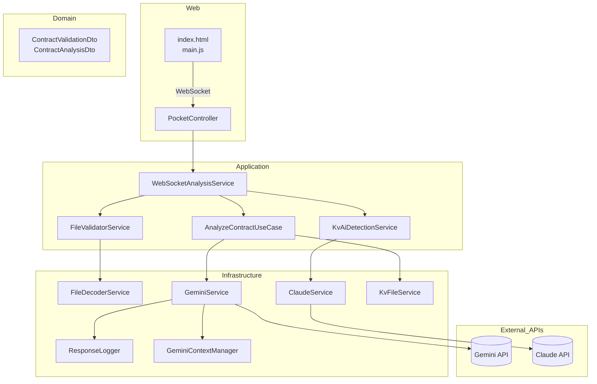
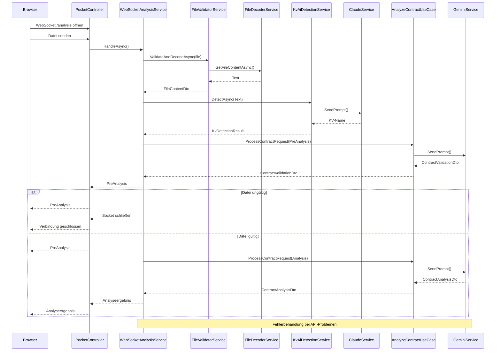
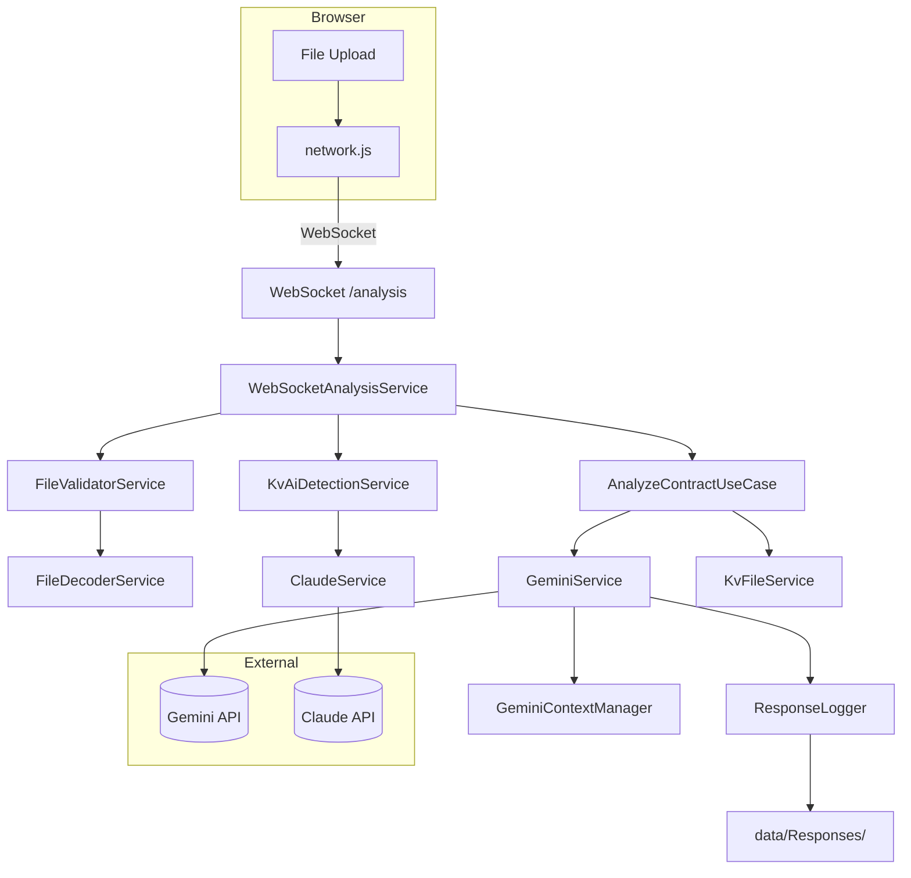
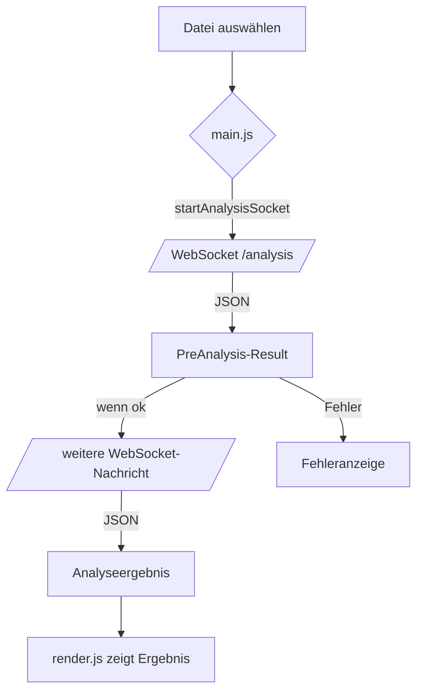
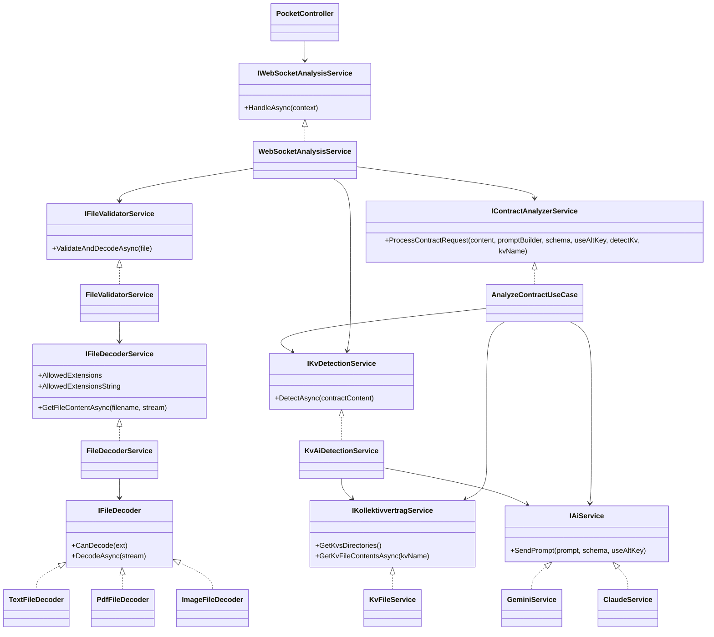

# Projekt-Diagramme

## Layered Component Diagram

## Domänenmodell (DTOs)

## Sequence Diagram with Layers

## Datenfluss-/Kontextdiagramm

## UI-/Flow-Diagramm

## UML-Übersicht der Services

