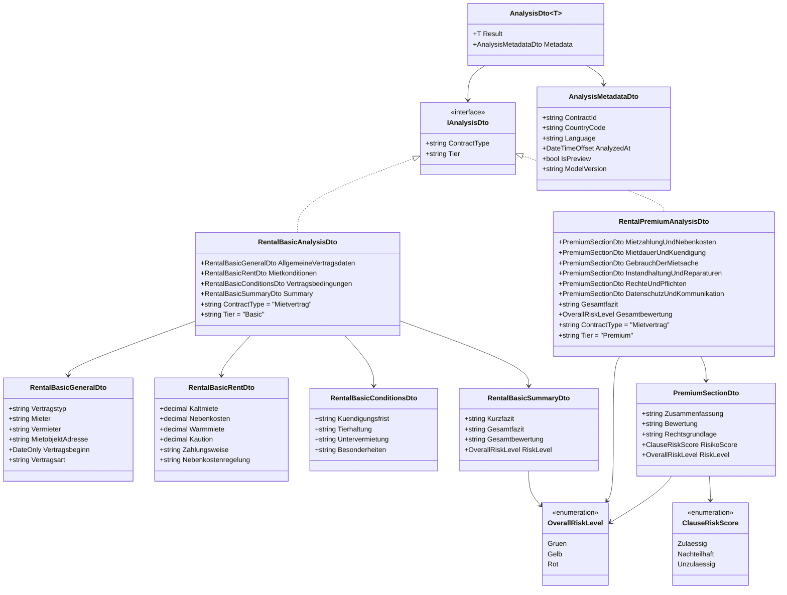
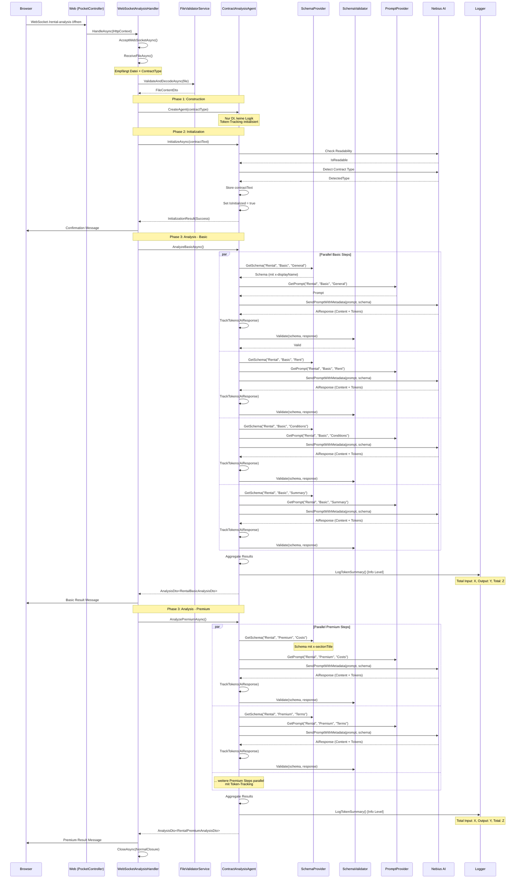
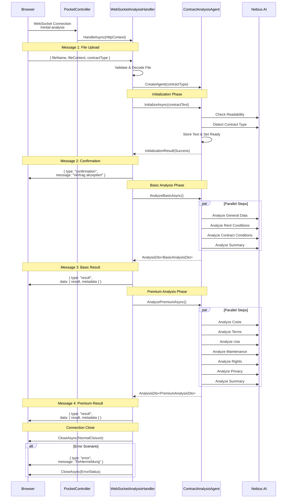
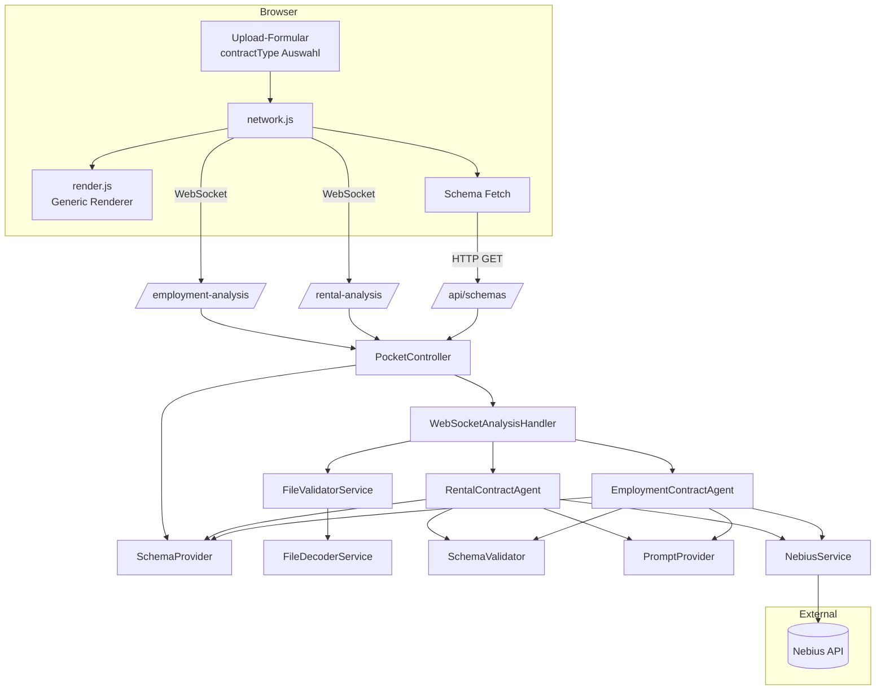
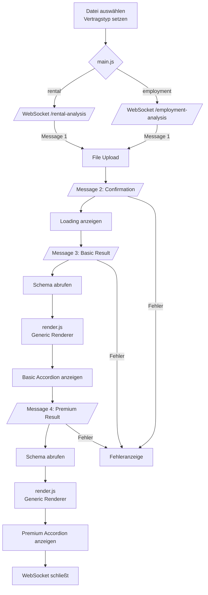
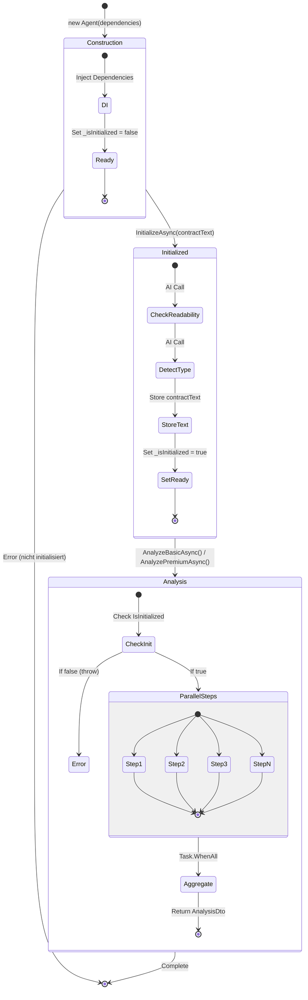
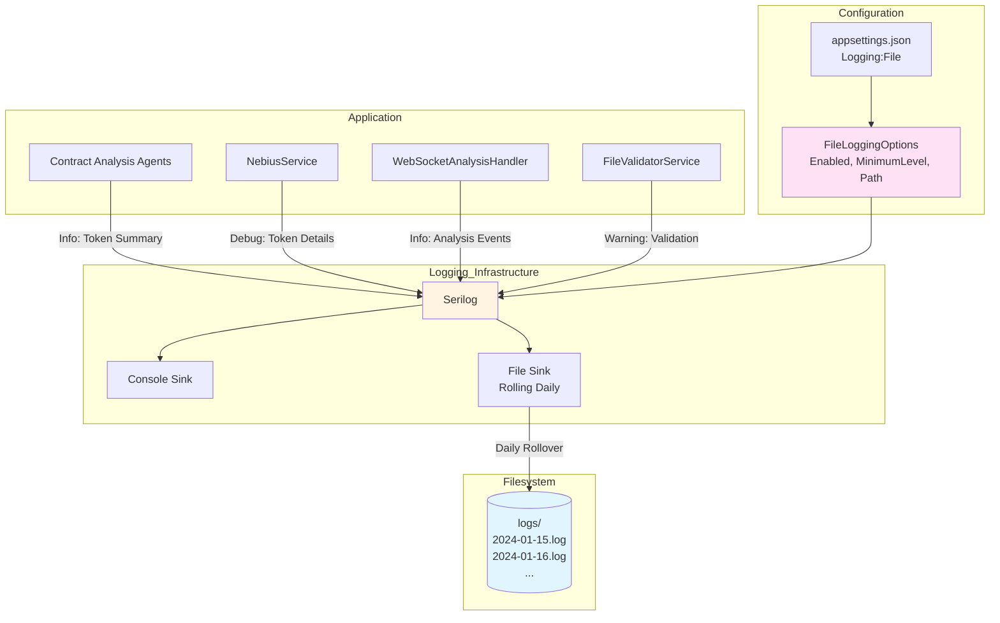
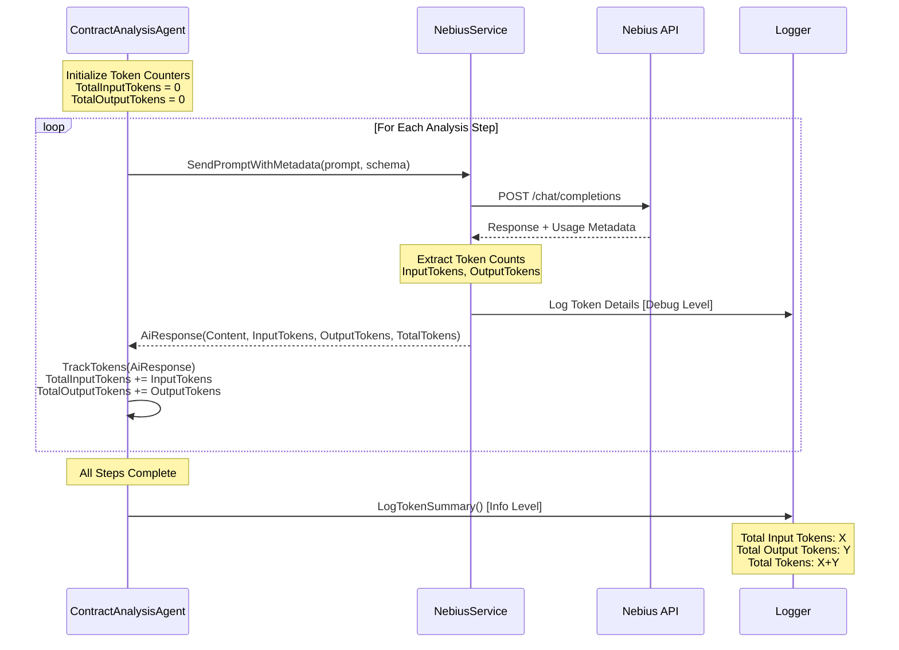
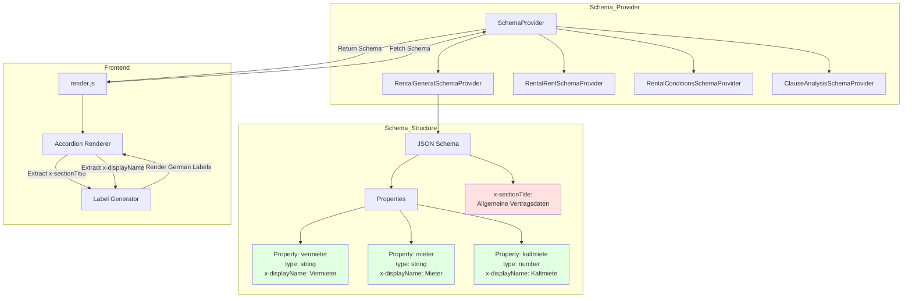
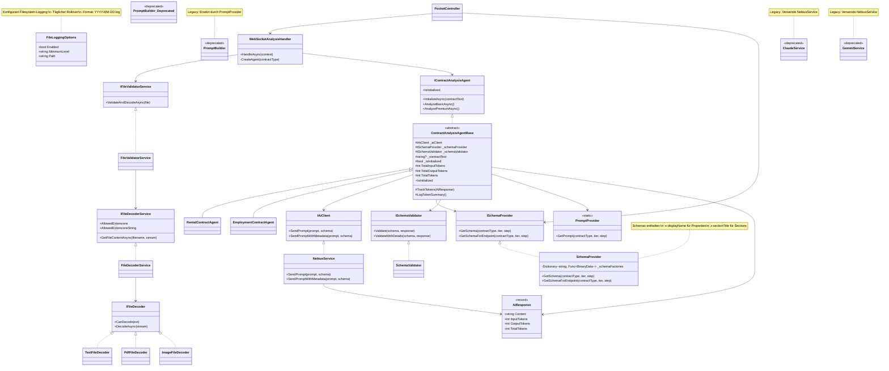

# Projekt-Diagramme

## Layered Component Diagram

```mermaid
classDiagram
    subgraph Web
        FE[index.html<br>main.js<br>render.js]
        NET[network.js]
        PC[PocketController]
    end
    subgraph Application
        RCA[RentalContractAgent<br>+ Token Tracking]
        ECA[EmploymentContractAgent<br>+ Token Tracking]
        ICAA[IContractAnalysisAgent]
        AR[AiResponse Record<br>Content, InputTokens,<br>OutputTokens, TotalTokens]
    end
    subgraph Domain
        DTOs[AnalysisDto<br>RentalBasicAnalysisDto<br>RentalPremiumAnalysisDto<br>EmploymentAnalysisDto]
        PP[PromptProvider]
    end
    subgraph Infrastructure
        WSH[WebSocketAnalysisHandler]
        FVS[FileValidatorService]
        FDS[FileDecoderService]
        SP[SchemaProvider<br>+ x-displayName<br>+ x-sectionTitle]
        SV[SchemaValidator]
        NEB[NebiusService<br>+ SendPromptWithMetadata]
        LOG[Serilog<br>Filesystem Logging]
    end
    subgraph External_APIs
        NebiusAPI[(Nebius API)]
    end
    subgraph Filesystem
        LOGS[(logs/<br>YYYY-MM-DD.log)]
    end

    FE --> NET
    NET -- WebSocket --> PC
    PC --> WSH
    WSH --> FVS
    FVS --> FDS
    WSH --> ICAA
    ICAA <|.. RCA
    ICAA <|.. ECA
    RCA --> SP
    RCA --> SV
    RCA --> PP
    RCA --> NEB
    RCA --> AR
    RCA --> LOG
    ECA --> SP
    ECA --> SV
    ECA --> PP
    ECA --> NEB
    ECA --> AR
    ECA --> LOG
    NEB --> NebiusAPI
    NEB --> AR
    LOG --> LOGS
```

## Domänenmodell (DTOs)

Das neue System verwendet eine generische AnalysisDto-Struktur mit Metadata. Alle Analyse-Ergebnisse implementieren `IAnalysisDto` und werden in einem `AnalysisDto<T>` Wrapper mit Metadaten zurückgegeben.



## PlantUML

```plantuml
@startuml
skinparam classAttributeIconSize 0

interface IAiClient {
    +Task<string> SendPrompt(string prompt, object? schema)
}

class NebiusService {
    -ILogger _logger
    -NebiusOptions _options
    +Task<string> SendPrompt(...)
}

IAiClient <|.. NebiusService

interface IFileDecoder {
    +bool CanDecode(string ext)
    +Task<string> DecodeAsync(Stream input)
}

class TextFileDecoder
class PdfFileDecoder
class ImageFileDecoder
IFileDecoder <|.. TextFileDecoder
IFileDecoder <|.. PdfFileDecoder
IFileDecoder <|.. ImageFileDecoder

interface IFileDecoderService {
    +string[] AllowedExtensions
    +string AllowedExtensionsString
    +Task<string> GetFileContentAsync(string filename, Stream content)
}

class FileDecoderService {
    -ILogger _logger
    -IEnumerable<IFileDecoder> _decoders
    +Task<string> GetFileContentAsync(...)
}
IFileDecoderService <|.. FileDecoderService
FileDecoderService --> IFileDecoder

interface IFileValidatorService {
    +Task<FileContentDto> ValidateAndDecodeAsync(IFormFile file)
}

class FileValidatorService {
    -ILogger _logger
    -IFileDecoderService _decoderService
    -UploadOptions _options
    +Task<FileContentDto> ValidateAndDecodeAsync(...)
}
IFileValidatorService <|.. FileValidatorService
FileValidatorService --> IFileDecoderService

interface ISchemaProvider {
    +BinaryData GetSchema(string contractType, string tier, string step)
    +JsonObject GetSchemaForEndpoint(string contractType, string tier, string step)
}

class SchemaProvider {
    -Dictionary<string, Func<BinaryData>> _schemaFactories
    +BinaryData GetSchema(...)
    +JsonObject GetSchemaForEndpoint(...)
}
ISchemaProvider <|.. SchemaProvider

interface ISchemaValidator {
    +bool Validate(JsonObject schema, JsonObject response)
    +ValidationResult ValidateWithDetails(JsonObject schema, JsonObject response)
}

class SchemaValidator {
    +bool Validate(...)
    +ValidationResult ValidateWithDetails(...)
}
ISchemaValidator <|.. SchemaValidator

class PromptProvider {
    <<static>>
    +string GetPrompt(string contractType, string tier, string step)
}

interface IContractAnalysisAgent {
    +Task<InitializationResult> InitializeAsync(string contractText)
    +Task<AnalysisDto<IAnalysisDto>> AnalyzeBasicAsync()
    +Task<AnalysisDto<IAnalysisDto>> AnalyzePremiumAsync()
    +bool IsInitialized
}

abstract class ContractAnalysisAgentBase {
    #IAiClient _aiClient
    #ISchemaProvider _schemaProvider
    #ISchemaValidator _schemaValidator
    #ILogger _logger
    #string? _contractText
    #bool _isInitialized
    +bool IsInitialized
    #{abstract} string ExpectedContractType
    +{abstract} Task<InitializationResult> InitializeAsync(string contractText)
    +{abstract} Task<AnalysisDto<IAnalysisDto>> AnalyzeBasicAsync()
    +{abstract} Task<AnalysisDto<IAnalysisDto>> AnalyzePremiumAsync()
}

class RentalContractAgent {
    #string ExpectedContractType = "Mietvertrag"
    +Task<InitializationResult> InitializeAsync(...)
    +Task<AnalysisDto<RentalBasicAnalysisDto>> AnalyzeBasicAsync()
    +Task<AnalysisDto<RentalPremiumAnalysisDto>> AnalyzePremiumAsync()
}

class EmploymentContractAgent {
    #string ExpectedContractType = "Arbeitsvertrag"
    +Task<InitializationResult> InitializeAsync(...)
    +Task<AnalysisDto<IAnalysisDto>> AnalyzeBasicAsync()
    +Task<AnalysisDto<IAnalysisDto>> AnalyzePremiumAsync()
}

IContractAnalysisAgent <|.. ContractAnalysisAgentBase
ContractAnalysisAgentBase <|-- RentalContractAgent
ContractAnalysisAgentBase <|-- EmploymentContractAgent
ContractAnalysisAgentBase --> IAiClient
ContractAnalysisAgentBase --> ISchemaProvider
ContractAnalysisAgentBase --> ISchemaValidator
ContractAnalysisAgentBase --> PromptProvider

class WebSocketAnalysisHandler {
    -ILogger _logger
    -IFileValidatorService _fileValidatorService
    -IServiceProvider _serviceProvider
    +Task HandleAsync(HttpContext context)
    -IContractAnalysisAgent CreateAgent(string contractType)
}
WebSocketAnalysisHandler --> IFileValidatorService
WebSocketAnalysisHandler --> IContractAnalysisAgent

class PocketController {
    -ILogger _logger
    +Task RentalAnalysis()
    +Task EmploymentAnalysis()
    +Task GetSchema(string contractType, string tier, string step)
}
PocketController --> WebSocketAnalysisHandler
PocketController --> ISchemaProvider

record InitializationResult {
    +bool Success
    +string? ErrorMessage
}

record AnalysisDto~T~ {
    +T Result
    +AnalysisMetadataDto Metadata
}

record AnalysisMetadataDto {
    +string ContractId
    +string CountryCode
    +string Language
    +DateTimeOffset AnalyzedAt
    +bool IsPreview
    +string ModelVersion
}
@enduml
```

## Agent Lifecycle Sequence Diagram (with Token Tracking)



## WebSocket Message Flow Diagram



## Datenfluss-/Kontextdiagramm



## UI-/Flow-Diagramm



## 3-Phasen Agent Lifecycle



## Logging Architecture Diagram



## Token Tracking Flow Diagram



## Schema Provider with x-displayName



## UML-Übersicht der Services


