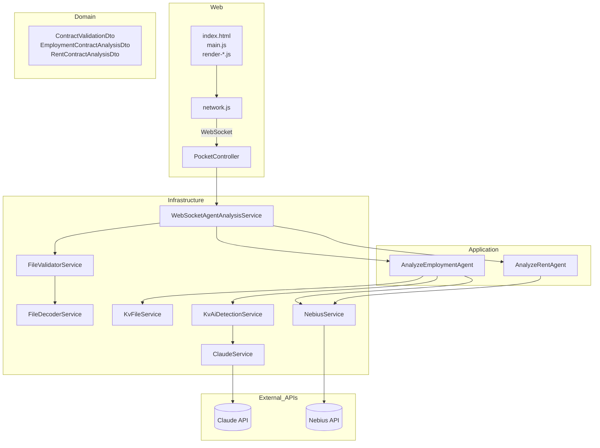
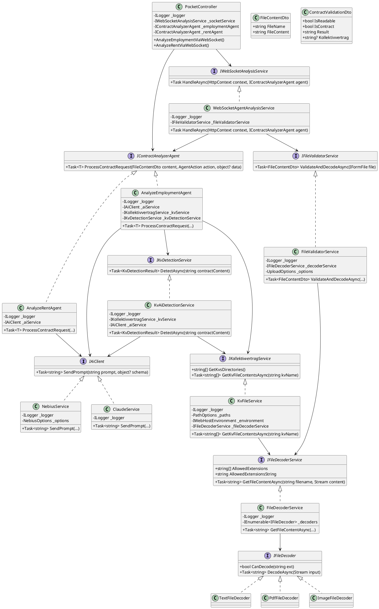
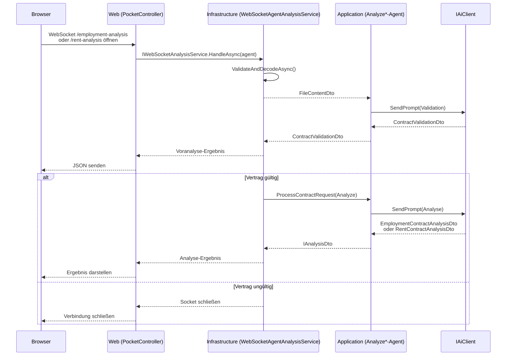
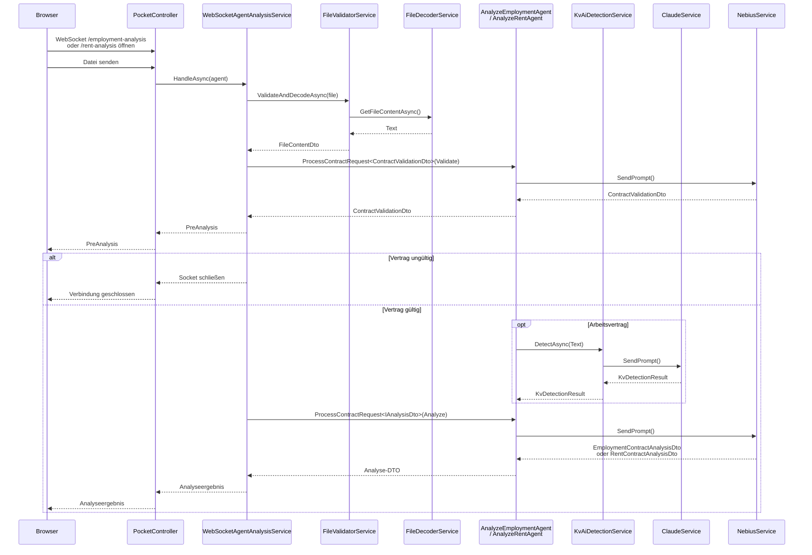
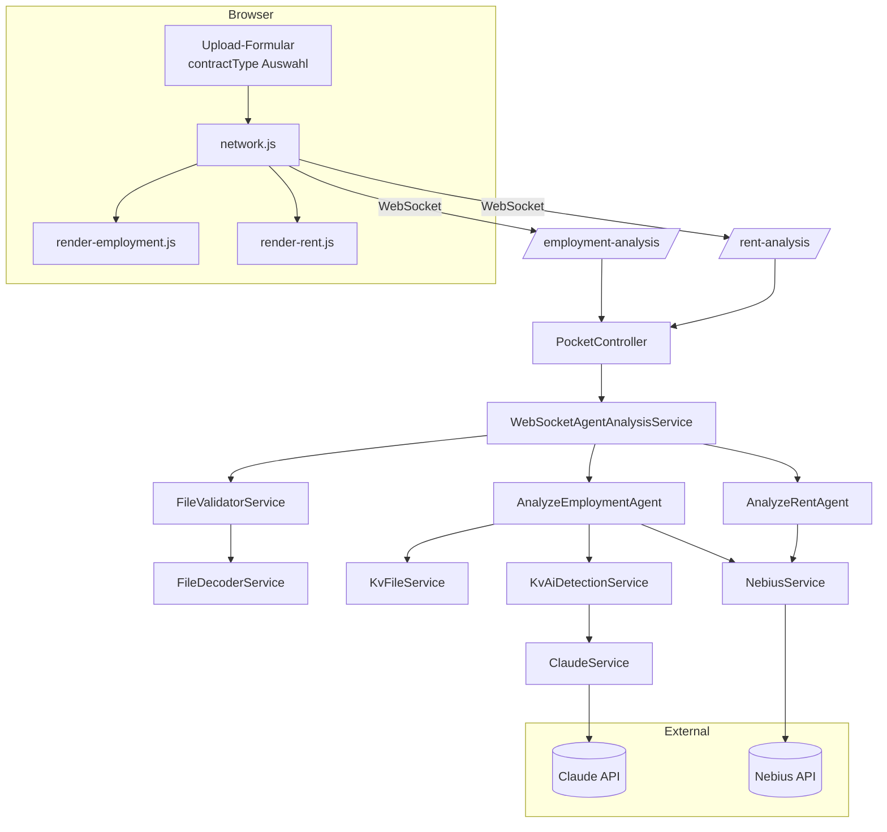
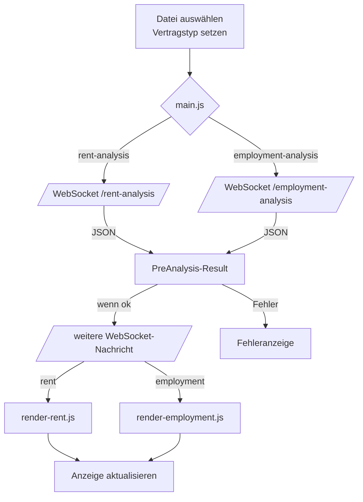
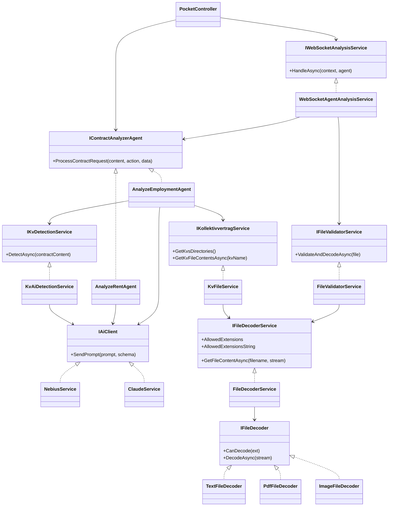

# Projekt-Diagramme

## Layered Component Diagram

## Domänenmodell (DTOs)

Die Pre-Analyse liefert weiterhin ein `ContractValidationDto`, die eigentliche Auswertung unterscheidet jetzt aber zwischen Arbeits-
und Mietverträgen. Beide Ergebnis-DTOs implementieren `IAnalysisDto`. Zur besseren Lesbarkeit sind die verschachtelten Klassen der
Employment-Analyse im Diagramm mit dem Präfix `Employment*` versehen.

```mermaid
classDiagram
    class IValidationDto
    class IAnalysisDto

    class ContractValidationDto {
        IsReadable: bool
        IsContract: bool
        Result: string
        Kollektivvertrag: string
    }
    IValidationDto <|.. ContractValidationDto

    class EmploymentContractAnalysisDto {
        Keypoints: EmploymentSummary
        UnzulaessigeKlauseln: EmploymentProblemKlausel[]
        NachteileKlauseln: EmploymentProblemKlausel[]
        WiderspruechlicheKlauseln: EmploymentWiderspruechlicheKlausel[]
        VorteilhafteKlauseln: EmploymentVorteilKlausel[]
        Fazit: string
        Kollektivvertrag: string
    }

    class EmploymentSummary {
        <<nested>>
        Arbeitgeber: string
        Taetigkeit: string
        Beginn: string
        Dauer: string
        GehaltBrutto: string
        Zuschlaege: string
        Arbeitsstunden: string
        Ueberstunden: string
        Probezeit: string
    }

    class EmploymentProblemKlausel {
        <<nested>>
        Titel: string
        Zitat: string
        Problem: string
        Rechtsgrundlage: EmploymentRechtsgrundlage[]
    }

    class EmploymentWiderspruechlicheKlausel {
        <<nested>>
        Titel: string
        ZitatKlauselA: string
        ZitatKlauselB: string
        Problem: string
        Rechtsgrundlage: EmploymentRechtsgrundlage[]
    }

    class EmploymentVorteilKlausel {
        <<nested>>
        Titel: string
        Zitat: string
        Vorteil: string
    }

    class EmploymentRechtsgrundlage {
        <<nested>>
        Rechtsgrundlage: string
        Wortlaut: string
    }

    class RentContractAnalysisDto {
        Keypoints: RentSummary
        UnzulaessigeKlauseln: RentProblemKlausel[]
        NachteileKlauseln: RentProblemKlausel[]
        WiderspruechlicheKlauseln: RentWiderspruechlicheKlausel[]
        VorteilhafteKlauseln: RentVorteilKlausel[]
        Fazit: string
        Kollektivvertrag: string
    }

    class RentSummary {
        Vermieter: string
        Mieter: string
        Beginn: string
        Dauer: string
        Mindestdauer: string
        Kuendigungsfrist: string
        MieteKalt: string
        Betriebskosten: string
        Wohnflaeche: string
        Zimmer: int
        ImMietgegenstandEnthalten: string
    }

    class RentProblemKlausel {
        Titel: string
        Zitat: string
        Problem: string
        Rechtsgrundlage: RentRechtsgrundlage[]
    }

    class RentWiderspruechlicheKlausel {
        Titel: string
        ZitatKlauselA: string
        ZitatKlauselB: string
        Problem: string
        Rechtsgrundlage: RentRechtsgrundlage[]
    }

    class RentVorteilKlausel {
        Titel: string
        Zitat: string
        Vorteil: string
    }

    class RentRechtsgrundlage {
        Rechtsgrundlage: string
        Wortlaut: string
    }

    IAnalysisDto <|.. EmploymentContractAnalysisDto
    IAnalysisDto <|.. RentContractAnalysisDto

    EmploymentContractAnalysisDto --> EmploymentSummary
    EmploymentContractAnalysisDto --> EmploymentProblemKlausel
    EmploymentContractAnalysisDto --> EmploymentWiderspruechlicheKlausel
    EmploymentContractAnalysisDto --> EmploymentVorteilKlausel
    EmploymentProblemKlausel --> EmploymentRechtsgrundlage
    EmploymentWiderspruechlicheKlausel --> EmploymentRechtsgrundlage

    RentContractAnalysisDto --> RentSummary
    RentContractAnalysisDto --> RentProblemKlausel
    RentContractAnalysisDto --> RentWiderspruechlicheKlausel
    RentContractAnalysisDto --> RentVorteilKlausel
    RentProblemKlausel --> RentRechtsgrundlage
    RentWiderspruechlicheKlausel --> RentRechtsgrundlage
```

## PlantUML

## Onion-Layer Sequence Diagram

## Sequence Diagram

## Datenfluss-/Kontextdiagramm

## UI-/Flow-Diagramm

## UML-Übersicht der Services

