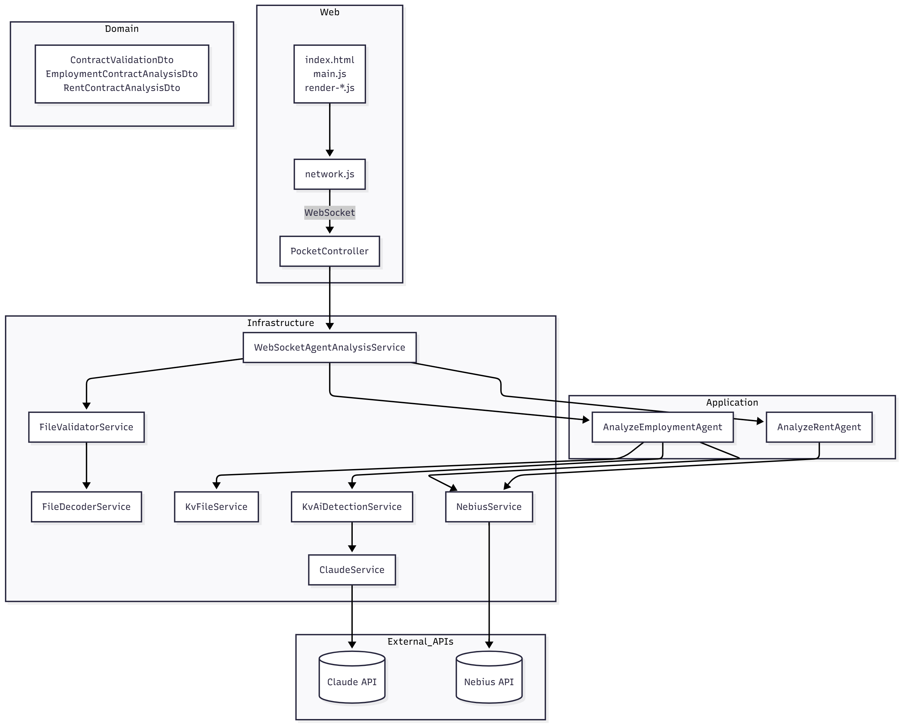
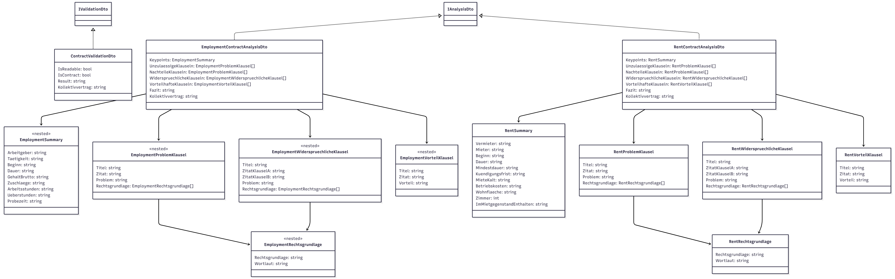
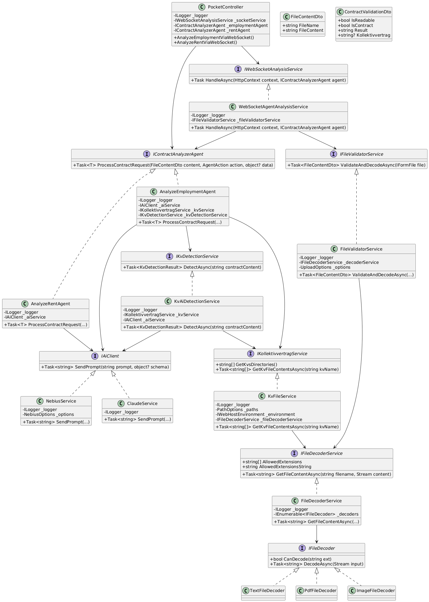
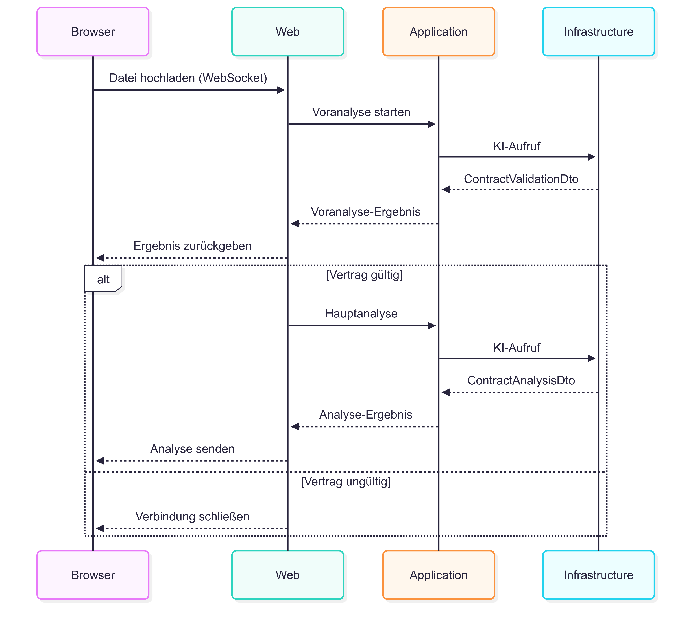
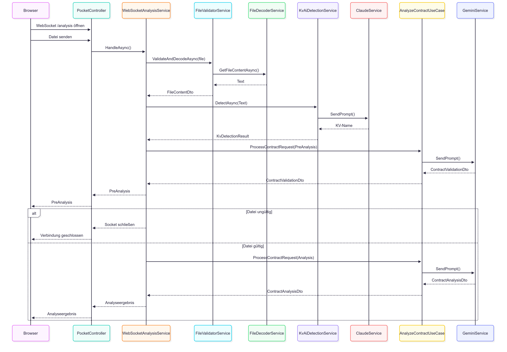
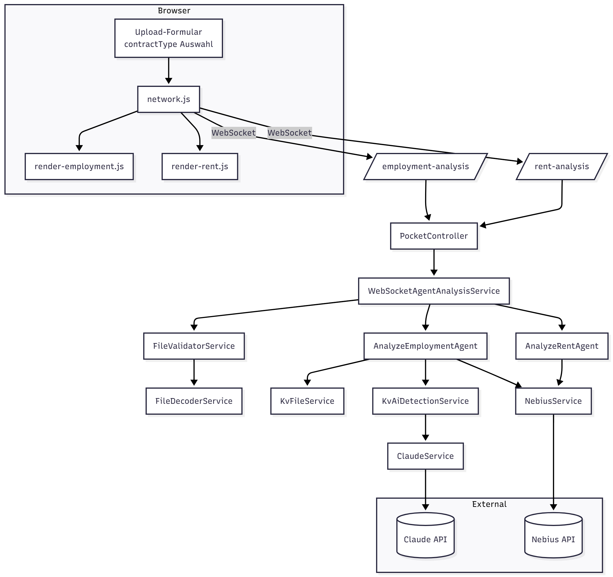
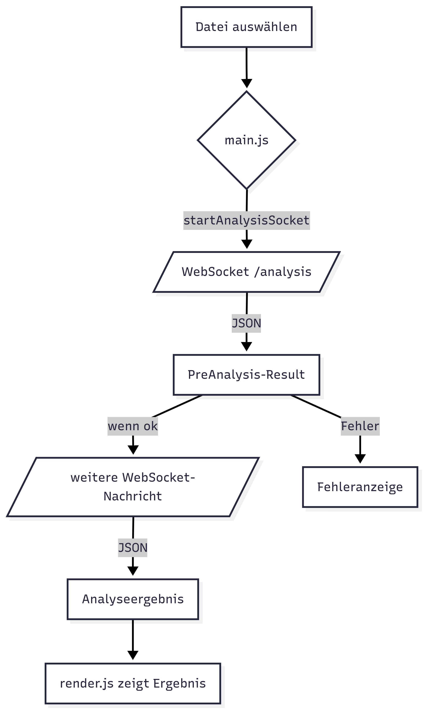
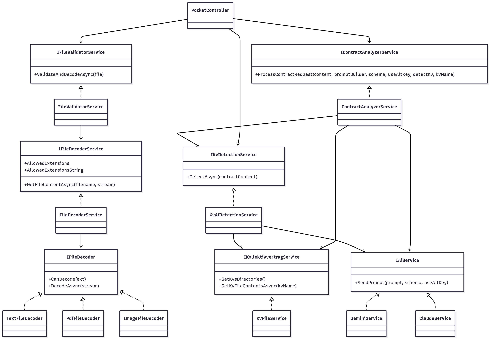

# Projekt-Diagramme (Bilder)

## Layered Component Diagram

## Domänenmodell (DTOs)

## PlantUML

## Onion-Layer Sequence Diagram

## Sequence Diagram

## Datenfluss-/Kontextdiagramm

## UI-/Flow-Diagramm

## UML-Übersicht der Services

